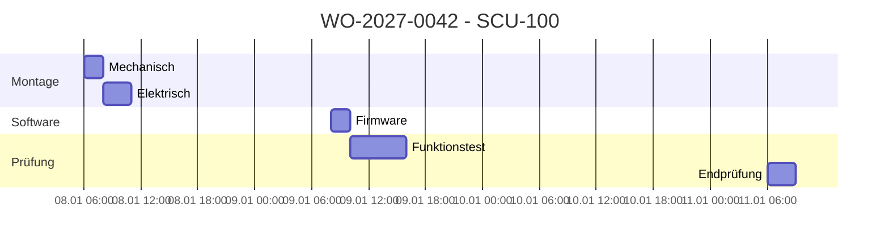

# Kapazitätsplanung und Fertigung

**Werkzeuganleitungen:** [ERPNext](../../tools/user/erpnext.md) für Work Order
und Job Cards, [Paperless-ngx](../../tools/user/paperless.md) für gültige
Arbeitsunterlagen und [Shopfloor-Kurzanleitung](../../user-guides/shopfloor.md).

## Routing

| Folge | Arbeitsgang | Workstation | Dauer je Los | Parallelkapazität |
|---:|---|---|---:|---:|
| 10 | Mechanische Montage | WS-MECH | 60 min | 3 |
| 20 | Elektronikmontage | WS-ELEC | 90 min | 4 |
| 30 | Firmware aufspielen | WS-FW | 30 min | 2 |
| 40 | Funktionstest | WS-TEST-A | 120 min | 1 |
| 50 | Endprüfung | WS-QC | 45 min | 2 |

## Kapazitätsentscheidung

ERPNext plant die Job Cards gegen Kalender, Schicht und belegte Slots. Im
Demodatensatz ist Prüfstand A mit 91 Prozent der Engpass. Der Auftrag bleibt
terminierbar, solange keine weitere Störung hinzukommt.



## Freigabekriterien für WO-2027-0042

- [x] Kundenauftrag ist bestätigt.
- [x] BOM und Routing sind freigegeben.
- [x] Zeichnung Rev. C ist gültig.
- [x] Montageanweisung Rev. D ist gültig.
- [ ] Alle Kaufteile sind verfügbar.
- [ ] Job Cards sind terminiert.

## Rückmeldungen

Jede Rückmeldung enthält mindestens:

```json
{
  "work_order": "WO-2027-0042",
  "job_card": "JC-2027-0130",
  "operation": "Elektronikmontage",
  "serial_numbers": ["SN-10001", "SN-10002"],
  "started_at": "2027-01-08T08:00:00+01:00",
  "completed_at": "2027-01-08T09:42:00+01:00",
  "good_quantity": 2,
  "scrap_quantity": 0,
  "operator": "employee:471"
}
```

## Systemgrenze

ERPNext bleibt führend für Work Order, BOM, Materialverbrauch und Kosten. Eine
spätere MES-Erweiterung optimiert Shopfloor-Bedienung, Maschinenanbindung und
hochfrequente Messwerte, ohne Stammdaten zu duplizieren.
