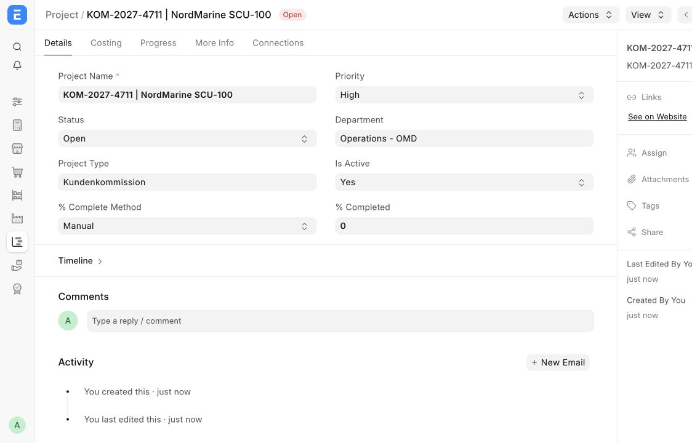
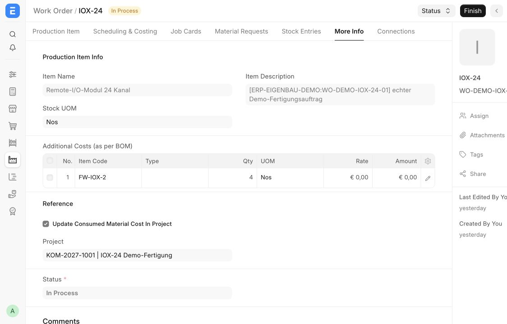
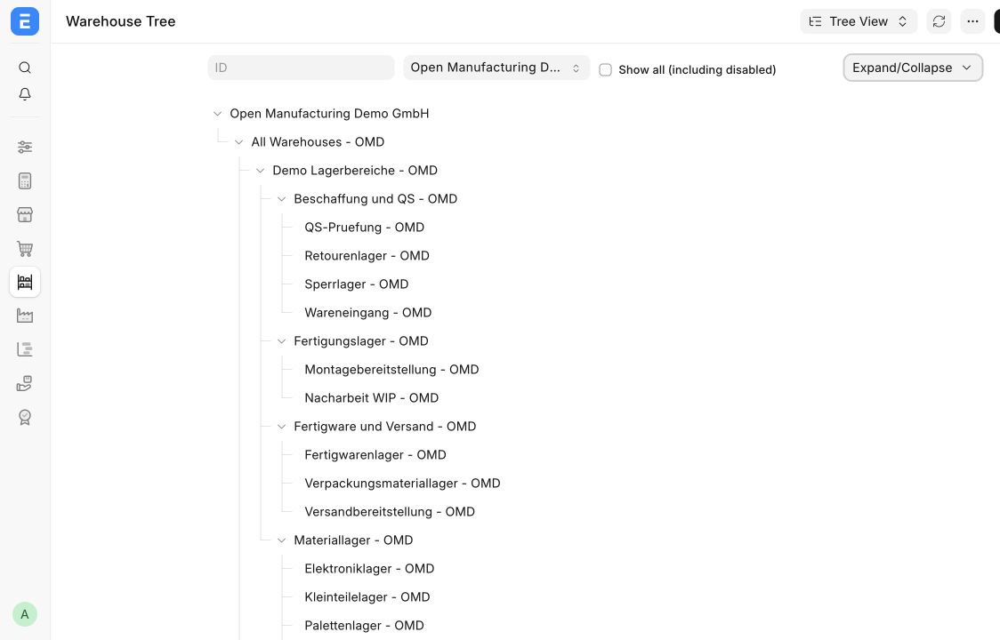
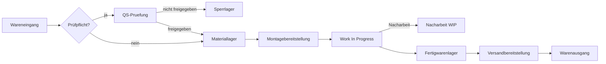

# Projekte, Kommissionen und Lagerbereiche

ERPNext kann ein **Project** als auftragsübergreifende Kommissionsklammer
verwenden. Verkauf, Einkauf, Wareneingang, Fertigung, Lagerbewegung, Zeit,
Lieferung und Rechnung tragen dabei dieselbe Projektreferenz. Das Lager sagt,
**wo** sich Material befindet; das Projekt sagt, **für welche Kommission** der
Vorgang erfolgt.

## Was ein Projektbereich abbildet

Ein Projekt bündelt:

- Kommissionsnummer und Bezeichnung,
- Kunde, Zeitraum, Status, Priorität und verantwortliche Abteilung,
- Tasks, Timesheets und Fortschritt,
- Beschaffungs-, Fertigungs-, Lager- und Verkaufsbelege mit Projektfeld,
- geplante und tatsächliche Kosten sowie Erlöse, sofern die Belege konsequent
  mit derselben Projektreferenz gebucht werden,
- Anhänge, Kommentare und Verknüpfungen im ERPNext-Projektdashboard.



**Navigation:** `Projects > Project > KOM-2027-4711`.

!!! info "Projekt ist kein eigener Mandant"
    Ein Projekt ist eine Auswertungs- und Referenzdimension. Es ersetzt weder
    Firma, Kostenstelle, Lager noch Berechtigungskonzept. Sichtbarkeit nach
    Projekt erfordert bei Bedarf zusätzliche User Permissions.

## Vorbereitete Kommissionen

| Kommission | Typ | Bezug | Zweck |
|---|---|---|---|
| `KOM-2027-4711` | Kundenkommission | NordMarine Systems GmbH / SCU-100 | kompletter Kundenauftragsprozess |
| `KOM-2027-1001` | Interne Fertigung | `WO-DEMO-IOX-24-01` | IOX-24-Demofertigung |
| `KOM-2027-1002` | Interne Fertigung | `WO-DEMO-GW-EDGE-01` | Gateway-Demofertigung |
| `KOM-2027-1003` | Interne Fertigung | `WO-DEMO-HMI-070-01` | HMI-Demofertigung |

Die drei vorhandenen Demo-Work-Orders tragen bereits ihre interne Kommission.



## Namens- und Pflegeregel

Empfohlenes Schema:

```text
KOM-<Jahr>-<laufende Nummer>
```

Der stabile Schlüssel steht im Dokumentnamen, die sprechende Bezeichnung im
Project Name, zum Beispiel `KOM-2027-4711 | NordMarine SCU-100`.

Pflichtangaben für eine neue Kommission:

| Feld | Regel |
|---|---|
| Project Name | Kommissionsnummer plus Kunde/Produkt oder Vorhaben |
| Project Type | Kundenkommission oder Interne Fertigung |
| Company | buchende Gesellschaft |
| Customer | bei Kundenkommissionen verpflichtend |
| Department | organisatorisch verantwortliche Abteilung |
| Expected Start/End | realistischer Projektzeitraum |
| Status / Priority | Arbeitsvorrat und Eskalation |
| Notes | Leistungsumfang, Auftrag/Produkt und Abgrenzung |

Eine Kommission wird nicht für jeden einzelnen Lagerbeleg neu angelegt. Alle
fachlich zusammengehörenden Belege verwenden dieselbe Nummer.

## Welche Belege können die Kommission tragen?

Die installierte ERPNext-Version besitzt ein Projektfeld auf:

- Sales Order,
- Purchase Order,
- Purchase Receipt,
- Work Order,
- Stock Entry,
- Delivery Note,
- Sales Invoice,
- Timesheet und Timesheet-Zeilen.

Opportunity und Quotation besitzen in dieser Installation kein entsprechendes
Kopffeld. Dort wird die Kommissionsnummer vor Auftragserteilung bei Bedarf im
Titel bzw. in der Kundenreferenz dokumentiert. Führend wird die Zuordnung ab
der Sales Order.

### Durchgängiger Ablauf

1. Kundenkommission anlegen und Kunde, Zeitraum, Abteilung und Priorität
   eintragen.
2. In der Sales Order im Feld **Project** `KOM-2027-4711` wählen.
3. Material Requests/Purchase Orders aus dem Auftrag ableiten und das Project
   auf jedem Beschaffungsbeleg prüfen.
4. Purchase Receipt, Work Order und kommissionsbezogene Stock Entries mit
   derselben Referenz buchen.
5. Job-Card-Zeiten bzw. Timesheets auf die Kommission erfassen.
6. Delivery Note und Sales Invoice mit dem Projekt prüfen.
7. Projektkosten, Zeiten, Einkaufsvolumen, Erlöse und offene Belege abstimmen;
   erst danach Projektstatus auf **Completed** setzen.

!!! warning "Projektübernahme immer kontrollieren"
    ERPNext übernimmt Project bei manchen aus Vorgängerbelegen erzeugten
    Dokumenten, aber nicht in jeder Konstellation und Anpassung automatisch.
    Das Feld ist deshalb Bestandteil jedes Übergabegates.

## Vorbereitete Lagerhierarchie

Die bestehenden technischen Standardlager `Stores`, `Work In Progress`,
`Finished Goods` und `Goods In Transit` bleiben erhalten. So werden vorhandene
Bestände und Demo-Buchungen nicht umgehängt. Zusätzlich steht folgende
operative Struktur zur Auswahl:



```text
Demo Lagerbereiche
├── Beschaffung und QS
│   ├── Wareneingang
│   ├── QS-Pruefung
│   ├── Sperrlager
│   └── Retourenlager
├── Materiallager
│   ├── Kleinteilelager
│   ├── Elektroniklager
│   ├── Palettenlager
│   └── Verbrauchsmateriallager
├── Fertigungslager
│   ├── Montagebereitstellung
│   └── Nacharbeit WIP
└── Fertigware und Versand
    ├── Fertigwarenlager
    ├── Versandbereitstellung
    └── Verpackungsmateriallager
```

**Navigation:** `Stock > Warehouse`, Ansicht **Tree View**, anschließend
**Expand/Collapse > Expand All**.

## Verwendung der Lagerbereiche

| Lager | Verwendung | Typischer Zugang | Typischer Abgang |
|---|---|---|---|
| Wareneingang | noch nicht geprüfte Anlieferung | Purchase Receipt/Transfer | QS oder direkt Materiallager |
| QS-Pruefung | prüfpflichtiges Material | Wareneingang | freies Lager oder Sperrlager |
| Sperrlager | gesperrte/unklare Ware | QS, Fertigung, Retoure | Nacharbeit, Rücksendung, Freigabe |
| Retourenlager | Kunden-/Lieferantenretouren | Rücklieferung | Prüfung, Verschrottung, Rücksendung |
| Kleinteilelager | Schrauben, Stecker, Klemmen, kleine Komponenten | freigegebener Zugang | Kommissionierung/Fertigung |
| Elektroniklager | Platinen, Displays, Netzteile, SSDs | freigegebener Zugang | Fertigung |
| Palettenlager | Gehäuse, Großteile und palettierte Mengen | freigegebener Zugang | Fertigung/Versand |
| Verbrauchsmateriallager | Hilfs- und Betriebsstoffe | Einkauf | Fertigung/Instandhaltung |
| Montagebereitstellung | kommissioniertes Material vor Start | Materiallager | WIP/Verbrauch |
| Nacharbeit WIP | physisch separierte Nacharbeit | Fertigung/Qualität | erneute Prüfung/Fertigware |
| Fertigwarenlager | freigegebene Fertigprodukte | Manufacture | Versandbereitstellung |
| Versandbereitstellung | gepackte, versandbereite Ware | Fertigwarenlager | Delivery Note/Warenausgang |
| Verpackungsmateriallager | Kartons, Paletten, Füllmittel | Einkauf | Versand |

Die neuen Lager sind zunächst leer. Vorhandener Demobestand bleibt in
`Stores - OMD`. Material wird nur durch gebuchte Stock Entries umgelagert;
eine reine Änderung des Lagerstamms verschiebt keinen Bestand.

## Empfohlener Materialfluss



## Projekt und Lager gemeinsam buchen

Beispiel für eine kommissionsbezogene Umlagerung:

| Feld | Beispiel |
|---|---|
| Stock Entry Type | Material Transfer |
| Source Warehouse | `Elektroniklager - OMD` |
| Target Warehouse | `Montagebereitstellung - OMD` |
| Project | `KOM-2027-4711` |
| Item | `PCB-MAIN-42` |
| Purpose/Remarks | Bereitstellung SCU-100, Kundenauftrag referenzieren |

Das Project macht einen allgemeinen Lagerbestand nicht automatisch exklusiv
für die Kommission. Verbindliche Reservierung erfolgt über die vorgesehene
Auftrags-/Produktionslogik; physische Trennung erfolgt über Lager bzw.
Lagerplätze. Eigene Projektlager sind nur für große oder lang laufende
Vorhaben sinnvoll, da sonst die Lagerhierarchie unbeherrschbar wächst.

## Verantwortlichkeiten

- Auftragszentrum legt Kundenkommission an und setzt sie auf die Sales Order.
- Disposition/Einkauf übernehmen und kontrollieren sie auf Beschaffungsbelegen.
- Produktionsplanung setzt sie auf Work Order und Zeitbelegen.
- Lager wählt den tatsächlichen physischen Lagerbereich und prüft Project auf
  kommissionsbezogenen Stock Entries.
- Versand/Finanzen prüfen Project auf Delivery Note und Sales Invoice.
- Controlling schließt Kosten, Zeiten und Erlöse ab und beendet das Projekt.

Projekte und Warehouse-Hierarchien sind bereits über den kontrollierten
Testdaten-MCP importierbar. Offene Transaktionsbelege und deren Projektbezug
bleiben dagegen Bestandteil eines kontrollierten Cutovers; siehe
[Migration und API-Import](../../interfaces/migration-api.md).
