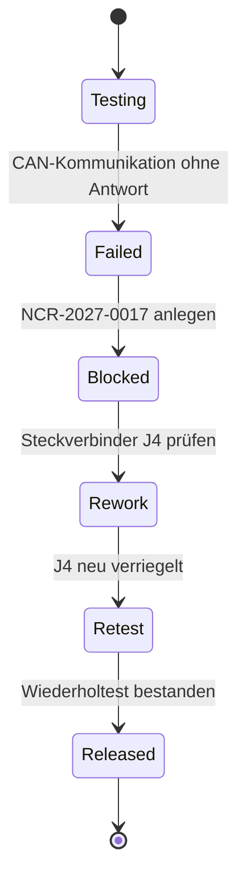

# Qualität, Abweichung und DMS

**Werkzeuganleitungen:** [ERPNext](../../tools/user/erpnext.md) für Sperre und
Abweichung, [Paperless-ngx](../../tools/user/paperless.md) für Prüfunterlagen
und [Shopfloor-Kurzanleitung](../../user-guides/shopfloor.md) für den Test.

## Prüfplan

| Prüfung | Soll / Grenze | Ergebnis im Happy Path |
|---|---|---|
| Versorgungsspannung | 24.0 V +/- 0.5 V | 24.1 V |
| Stromaufnahme | <= 2.0 A | 1.8 A |
| Temperaturtest | bestanden | bestanden |
| CAN-Kommunikation | 3/3 Telegramme | bestanden |
| Gehäuse-/Labelprüfung | ohne Abweichung | bestanden |

## Fehlerfall SN-10004

### Anwenderhandlung

1. Gerät SN-10004 im Shopfloor auswählen.
2. Messwert und Fehlerbeschreibung erfassen.
3. Abweichung NCR-2027-0017 mit Schweregrad **Major** anlegen.
4. Seriennummer und Lieferung sperren.
5. Nacharbeit „Steckverbinder J4 neu verriegeln“ dokumentieren.
6. Funktionstest vollständig wiederholen.
7. Bei Erfolg freigeben; bei erneutem Fehler eskalieren.
8. Prüfprotokoll in Paperless archivieren und verlinken.

## Dokumentenlenkung

| Dokument | Revision | Führendes System | Tags/Referenzen |
|---|---|---|---|
| Technische Zeichnung | C | Paperless | SCU-100, Revision-C |
| Montageanweisung | D | Paperless | SCU-100, Montage |
| Prüfplan | B | Paperless | SCU-100, Qualität |
| Lieferantenzertifikat | Charge BE-24117 | Paperless | PCB-MAIN-42, Charge |
| Abnahmeprotokoll | auftragsbezogen | Paperless | SO-4711, WO-2027-0042 |

## Audit-Anforderung

Die Freigabe muss unveränderbar auf Benutzer, Zeitpunkt, Prüfergebnis,
verwendete Dokumentrevisionen, Seriennummer und Abweichungsreferenz zeigen. Ein
LLM darf die Freigabe erklären oder vorbereiten, aber nicht eigenständig
erteilen.
