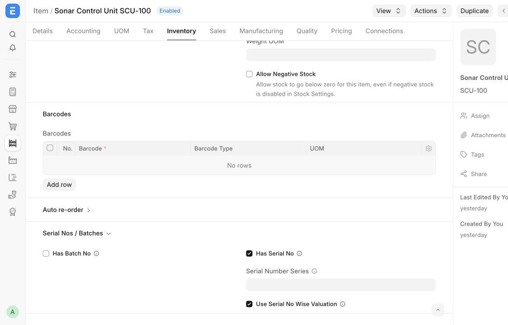
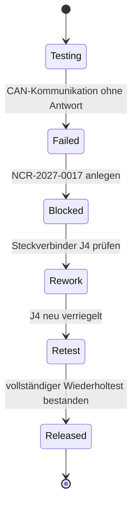

# Qualität, Abweichung und Dokumentenlenkung

**Verantwortlich:** Qualität
**Mitwirkend:** Wareneingang, Fertigung, Engineering
**Vorgänger:** prüfbereite Charge bzw. Geräte-Seriennummer
**Nachfolger:** [Fertigwareneinlagerung und Versand](delivery-accounting.md)
**Werkzeuge:** [ERPNext](../../tools/user/erpnext.md),
[Paperless-ngx](../../tools/user/paperless.md),
[FLOWQ Wareneingangsprüfung](../../user-guides/quality.md),
[Shopfloor-Anleitung](../../user-guides/shopfloor.md)

## Prüfarten und Buchungspunkt

| Prüfung | Auslöser | Prüfobjekt | Ergebnis |
|---|---|---|---|
| Wareneingangsprüfung | Purchase Receipt | Artikel + Charge/Seriennummer | akzeptiert, gesperrt oder retourniert |
| Zwischenprüfung | Job Card/Arbeitsgang | Work Order + Geräte-Seriennummer | Arbeitsgang freigegeben oder NCR |
| Funktionstest | Test-Job-Card | Geräte-Seriennummer | Messwerte und Pass/Fail |
| Endprüfung | letzte Job Card | Geräte-Seriennummer | Lieferfreigabe oder Sperre |
| Dokumentenprüfung | Freigabegate | Artikel/Revision/Auftrag | Nachweise vollständig oder Blockade |

## Wareneingangsprüfung mit FLOWQ

Der Purchase Receipt und die Bestandsentscheidung bleiben in ERPNext führend.
FLOWQ stellt davor eine reduzierte, scannerfreundliche Prüfoberfläche bereit:

1. Wareneingang, Bestellung, Artikel oder Charge scannen.
2. freigegebenen Prüfplan und Revision aus FLOWWORK/FLOWDOC laden.
3. Stichprobengröße nach festem, prozentualem, vollständigem oder
   konfiguriertem AQL-Verfahren ermitteln.
4. jede ausgewählte Probe anhand der Pflichtmerkmale prüfen.
5. Messwerte manuell oder über REST-, MQTT-, OPC-UA- beziehungsweise
   Seriell/USB-Gateway erfassen.
6. Kalibrierstatus, Einheit, Grenzwert und Idempotenz kontrollieren.
7. bei Erfolg das freie Ziellager, bei Fehler das Sperrlager und eine NCR
   vorbereiten.
8. ERP-Übergabe bestätigen und Prüfprotokoll in FLOWDOC ablegen.

FLOWQ ist eine getrennte Erweiterung und kein Fork des ERPNext-Kerncodes. Die
Schnittstellenbeschreibung enthält
[Messgeräte, ERP und DMS](../../interfaces/quality-measurement.md).

## Seriennummernführung prüfen

Im Artikelstamm unter **Inventory > Serial Nos / Batches** ist für das
Fertigprodukt **Has Serial No** aktiviert. Diese Einstellung muss vor der
ersten Bestandsbuchung feststehen.

Qualität erzeugt die Nummer nicht neu, sondern kontrolliert die von Fertigung
am physischen Gerät angebrachte und in der Fertigmeldung gebuchte Nummer. Jede
Prüfung, Abweichung und DMS-Referenz verwendet exakt diese ID.

## Funktionstest SCU-100

**Navigation:** zugehörige Job Card bzw. `Quality > Quality Inspection`.

| Prüfmerkmal | Soll / Grenze | Eingabe im Happy Path |
|---|---|---|
| Versorgungsspannung | 24,0 V ± 0,5 V | 24,1 V |
| Stromaufnahme | ≤ 2,0 A | 1,8 A |
| Temperaturtest | bestanden | bestanden |
| CAN-Kommunikation | 3/3 Telegramme | bestanden |
| Gehäuse-/Labelprüfung | ohne Abweichung | bestanden |

Pro Prüfergebnis sind mindestens zu erfassen:

- Quality-Inspection-/Job-Card- und Work-Order-Referenz,
- Artikel, Revision und Geräte-Seriennummer,
- Prüfplan und Dokumentrevision,
- Istwert, Einheit und Ergebnis je Merkmal,
- Prüfer, Prüfzeitpunkt und gegebenenfalls Messmittel,
- Abweichungsreferenz bei `Fail`.

`Accepted` darf erst gesetzt werden, wenn alle Pflichtmerkmale vorhanden und
innerhalb der gültigen Grenzen sind.

## Fehlerfall SN-10004

### Bildschirm- und Buchungsfolge

1. `SN-10004` in der Job Card/Quality Inspection auswählen.
2. tatsächlichen Messwert und beobachteten Fehler erfassen; Ergebnis `Rejected`
   bzw. `Fail` setzen.
3. Abweichung `NCR-2027-0017` mit Schweregrad **Major** anlegen.
4. Fehlerbild, vermutete Ursache, betroffene Menge und Sofortmaßnahme
   dokumentieren.
5. Seriennummer im ERP sperren und physisch eindeutig kennzeichnen; nicht ins
   Fertigwarenlager/Versand geben.
6. genehmigte Nacharbeit „Steckverbinder J4 neu verriegeln“ auf verantwortliche
   Person und Termin zuweisen.
7. nach Rückmeldung den vollständigen Prüfplan erneut ausführen – nicht nur das
   fehlgeschlagene Merkmal.
8. bei Erfolg NCR mit Wirksamkeitsnachweis schließen und Seriennummer
   freigeben; bei erneutem Fehler eskalieren.
9. Prüfprotokoll in Paperless archivieren und Dokument-ID im ERP verlinken.

## Dokumentenlenkung

| Dokument | Revision/Bezug | Führendes System | Pflichtmetadaten |
|---|---|---|---|
| Technische Zeichnung | C | Paperless | SCU-100, Revision C, Freigabestatus |
| Montageanweisung | D | Paperless | SCU-100, Montage, Gültigkeit |
| Prüfplan | B | Paperless | SCU-100, Qualität, Grenzwerte |
| Lieferantenzertifikat | Charge BE-24117 | Paperless | PCB-MAIN-42, Charge, PO/Receipt |
| Prüfprotokoll | je Seriennummer | Paperless | SN, WO, Prüfer, Datum, Ergebnis |
| Abnahmeprotokoll | auftragsbezogen | Paperless | SO-4711, WO, Seriennummern |

### Dokument in Paperless ablegen

1. PDF hochladen oder Consume-Ordner verwenden.
2. OCR-Ergebnis und Dokumenttyp prüfen.
3. eindeutigen Titel vergeben; Artikel, Revision, Charge/Seriennummer und
   Auftrag als Tags/Referenzen ergänzen.
4. Freigabestatus und Gültigkeit pflegen.
5. stabile Paperless-Dokument-ID in ERPNext referenzieren.

Eine neue Revision wird als neues Dokument bzw. neue Version mit eigener
Freigabe geführt. Laufende Work Orders behalten den eingefrorenen Stand, bis
eine genehmigte Änderungsentscheidung die Referenz ersetzt.

## Freigabegate vor Fertigmeldung/Lieferung

- [ ] Artikel, Revision und Seriennummer stimmen überein.
- [ ] alle Pflichtprüfungen vollständig und bestanden.
- [ ] keine offene Major-/Critical-Abweichung.
- [ ] Nacharbeit und Wiederholprüfung nachvollziehbar abgeschlossen.
- [ ] Zeichnung, Arbeitsanweisung, Prüfplan und Protokoll auffindbar.
- [ ] Qualitätsfreigabe enthält Benutzer und Zeitstempel.

!!! danger "Nicht durch KI freigeben"
    Eine KI darf Unterlagen suchen, Vollständigkeit prüfen und einen
    Entscheidungsvorschlag formulieren. Sperre, Wiederholprüfung und finale
    Qualitätsfreigabe bleiben einer berechtigten Person vorbehalten.

## Audit-Anforderung

Die Rückverfolgung muss unveränderbar auf Benutzer, Zeitpunkt, Artikel,
Revision, Seriennummer/Charge, Work Order, Prüfergebnisse, verwendete
Dokumentrevisionen, Abweichung und Freigabeentscheidung zeigen.
