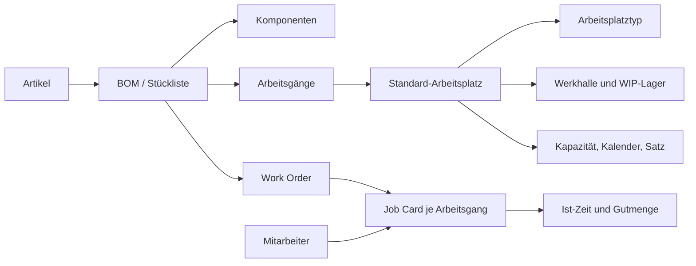
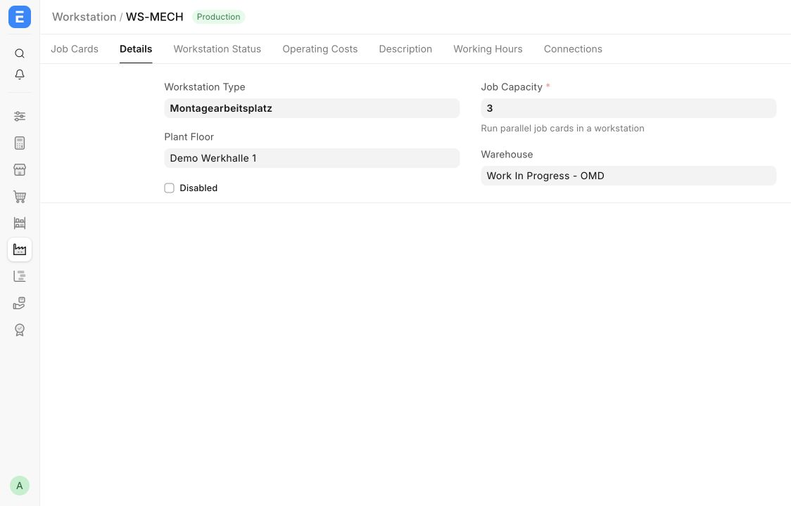
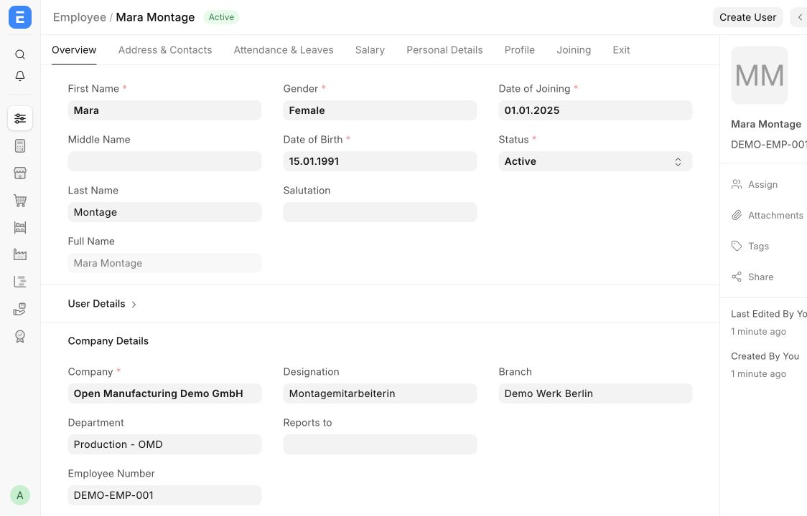
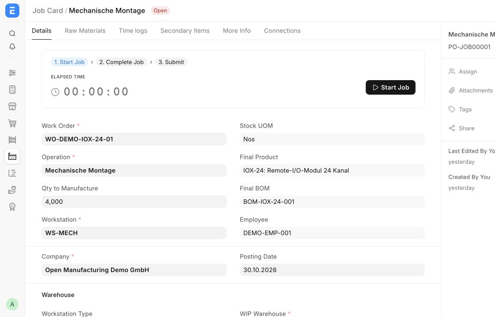
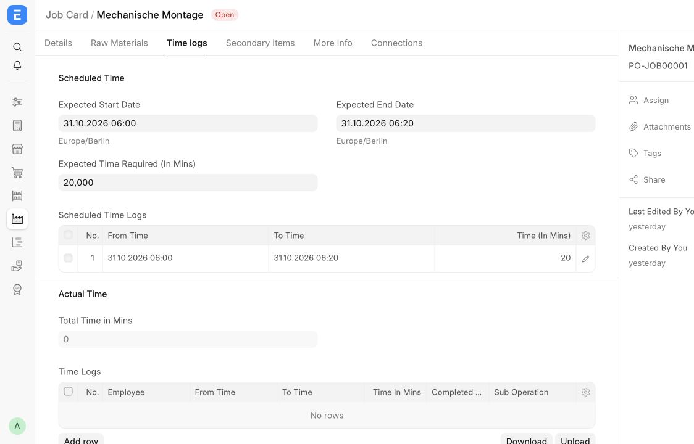
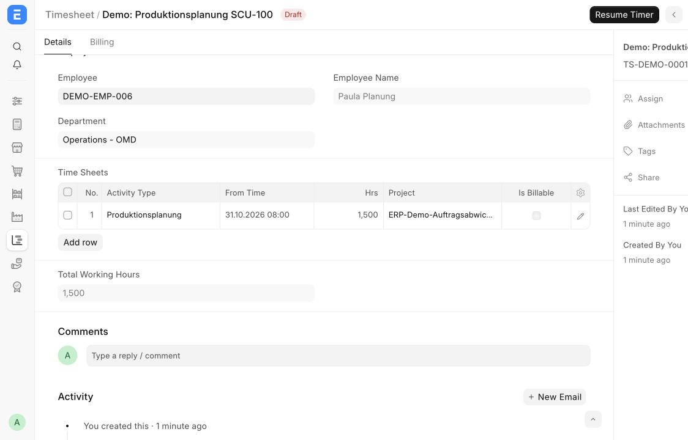

# Ressourcen, Mitarbeiter und Zeitverschreibung

Diese Anleitung erklärt das Ressourcenmodell von ERPNext und zeigt, wie die
vorbereiteten Demodaten für Arbeitsplätze, Mitarbeiter und Zeitbuchungen
getestet werden. Sie ergänzt die
[Produktionsanleitung](production.md), ohne dort Material- und
Seriennummernbuchungen zu wiederholen.

## So ist die Ressourcenliste in ERPNext aufgebaut

ERPNext verwendet keine einzelne gemischte Ressourcenliste wie manche
Prokom-Konfigurationen. Die Informationen sind fachlich getrennt und werden
über den Fertigungsauftrag zusammengeführt:

In der BOM stehen daher zwei Tabellen nebeneinander:

- **Items** enthält Material, Menge, Einheit und Quelllager.
- **Operations** enthält Reihenfolge, Arbeitsgang, Arbeitsplatz und Vorgabezeit.

Der Arbeitsgang verweist auf einen Standard-Arbeitsplatz. Beim Erzeugen einer
Work Order übernimmt ERPNext daraus Job Cards. Erst auf der Job Card wird ein
konkreter Mitarbeiter zugeordnet und die tatsächliche Zeit zurückgemeldet.

!!! info "Kein fester Mitarbeiter am Arbeitsplatz"
    Im ERPNext-Standard ist ein Mitarbeiter nicht dauerhaft einem Arbeitsplatz
    in der Stückliste zugeordnet. Der Arbeitsplatz ist die planbare Ressource;
    der Mitarbeiter wird je Job Card disponiert. Eine dauerhafte
    Qualifikations- oder Schichtmatrix wäre eine spätere Erweiterung.

## Vorbereitete Testarbeitsplätze

| Arbeitsplatz | Typ | Kapazität | Schicht | Satz/h | Standard-Arbeitsgang |
|---|---|---:|---|---:|---|
| `WS-MECH` | Montagearbeitsplatz | 3 | 06:00–14:00 | 62 EUR | Mechanische Montage |
| `WS-ELEC` | Elektronikarbeitsplatz | 4 | 06:00–14:00 | 72 EUR | Elektronikmontage |
| `WS-FW` | Software-Arbeitsplatz | 2 | 08:00–16:00 | 78 EUR | Firmware-Station |
| `WS-TEST-A` | Prüfstand | 1 | 06:00–22:00 | 95 EUR | Prüfstand A |
| `WS-QC` | Qualitätsarbeitsplatz | 2 | 06:00–14:00 | 82 EUR | Endprüfung |

Alle fünf Arbeitsplätze gehören zur **Demo Werkhalle 1**, verwenden das
WIP-Lager und den **Demo Schichtkalender 2027**. `Job Capacity` bedeutet, wie
viele Job Cards parallel am Arbeitsplatz laufen können; es ist nicht die Zahl
fest zugeordneter Mitarbeiter.

**Navigation:** `Manufacturing > Workstation > WS-MECH`.

## Vorbereitete Testmitarbeiter

Alle Personen sind rein fiktiv und besitzen bewusst kein ERP-Benutzerkonto.

| ID | Name | Abteilung | Funktion | Demozuordnung |
|---|---|---|---|---|
| `DEMO-EMP-001` | Mara Montage | Production | Montagemitarbeiterin | Mechanische Montage / `WS-MECH` |
| `DEMO-EMP-002` | Emil Elektronik | Production | Elektroniker | Elektronikmontage / `WS-ELEC` |
| `DEMO-EMP-003` | Fiona Firmware | Production | Firmwaretechnikerin | Firmware-Station / `WS-FW` |
| `DEMO-EMP-004` | Theo Test | Quality Management | Prüftechniker | Prüfstand A / `WS-TEST-A` |
| `DEMO-EMP-005` | Clara Qualität | Quality Management | Qualitätsprüferin | Endprüfung / `WS-QC` |
| `DEMO-EMP-006` | Paula Planung | Operations | Fertigungsplanerin | Timesheet/Planung |

**Navigation:** über die globale Suche `Employee` öffnen und nach
`DEMO-EMP-` filtern.

Ein **Employee** ist noch kein **User**. Für personenbezogene Rückmeldungen im
Produktivbetrieb braucht jede Bedienperson zusätzlich ein Benutzerkonto mit
passender Rolle und eine Verknüpfung im Mitarbeiterstamm. Die Demo vermeidet
absichtlich automatisch erzeugte Zugänge.

## Zuordnung zu Arbeitsgängen

Die Zuordnung ist in drei Ebenen sichtbar:

1. BOM-Operation bestimmt Arbeitsgang, Reihenfolge, Arbeitsplatz und Sollzeit.
2. Work Order erzeugt daraus eine Job Card je Arbeitsgang.
3. Produktionsplanung ordnet der offenen Job Card den ausführenden Employee zu.

Im Seed ist jede offene Demo-Job-Card bereits mit dem passenden
Testmitarbeiter vorbelegt. Beispiel:

**Navigation:** `Manufacturing > Job Card > PO-JOB00001`.

Die Zuordnung bedeutet Einsatzplanung, noch keine Zeitbuchung. Ein Wechsel ist
vor Arbeitsbeginn möglich; danach muss die Historie nachvollziehbar bleiben.

## Zeitweg A: Fertigungszeit auf der Job Card

Dieser Weg ist für Montage, Elektronik, Firmware und Prüfung maßgeblich, weil
Zeit, Arbeitsgang, Work Order, Arbeitsplatz und produzierte Menge gemeinsam
ausgewertet werden.

### Testablauf

1. `PO-JOB00001` öffnen und Work Order, Operation, Arbeitsplatz, Employee und
   Menge prüfen.
2. **Start Job** wählen. ERPNext erzeugt eine Ist-Zeitzeile mit Employee und
   Startzeit.
3. Für einen kurzen Test einige Minuten warten oder die Zeitzeile im Reiter
   **Time logs** kontrolliert bearbeiten.
4. **Complete Job** wählen und die tatsächlich fertiggestellte Menge erfassen.
5. Im Reiter **Time logs** Mitarbeiter, Von/Bis, Minuten und Completed Qty
   prüfen.
6. Nur abschließen/submitten, wenn der Arbeitsgang fachlich wirklich als
   erledigt gelten soll. Für wiederholbare Oberflächentests den Beleg als
   Entwurf offen lassen.

Die Spalten der Ist-Zeit sind:

| Feld | Bedeutung |
|---|---|
| Employee | ausführende Person |
| From Time / To Time | tatsächlicher Beginn und tatsächliches Ende |
| Time In Mins | aus den Zeitpunkten berechnete Dauer |
| Completed Qty | in diesem Zeitraum fertiggestellte Gutmenge |
| Sub Operation | optionaler untergeordneter Vorgang |

Pausen, Störungen oder Nacharbeit dürfen nicht als normale Gutzeit verschleiert
werden. Dafür sind separate Zeitzeilen bzw. ein definierter Stör-/Nacharbeits-
prozess erforderlich.

## Zeitweg B: Timesheet für Planung und Projektarbeit

Timesheets sind für Tätigkeiten gedacht, die nicht als Fertigungsrückmeldung
einer Job Card laufen, etwa Produktionsplanung, Projektarbeit, Engineering oder
Service. Vorbereitet sind die Activity Types **Fertigungszeit**, **Rüstzeit**,
**Qualitätsprüfung**, **Nacharbeit**, **Produktionsplanung** und
**Anwesenheitszeit**. Der letzte Typ wird ausschließlich durch die bestätigte
FLOWHR-Übergabe verwendet.

Das editierbare Beispiel `TS-DEMO-0001` enthält für Paula Planung 1,5 Stunden
am Projekt `ERP-Demo-Auftragsabwicklung`.

**Navigation:** `Projects > Timesheet > TS-DEMO-0001`.

### Eigenen Test anlegen

1. **New Timesheet** wählen und Company sowie Employee setzen.
2. unter **Time Sheets** eine Zeile hinzufügen.
3. Activity Type, From Time sowie To Time oder Hrs erfassen.
4. optional Project, Task, Beschreibung und Billable-Status ergänzen.
5. Überschneidungen mit anderen Zeitzeilen desselben Mitarbeiters vermeiden.
6. zunächst speichern; **Submit** erst nach fachlicher Prüfung.

## Zeitweg C: Anwesenheit und Abwesenheiten in FLOWHR

[FLOWHR](../../user-guides/hr.md) ergänzt die beiden ERP-Wege um persönliche
Anwesenheit und Zeitwirtschaft. Dort sind testbar:

- Kommen/Gehen und Tageszeitleiste,
- Soll-/Ist-Zeit, Tagessaldo, Zeitkonto und Resturlaub,
- Mindestpause, maximale Tageszeit, Feiertage und Wochenenden,
- Urlaub, Überstundenabbau, Mehrarbeit, mobiles Arbeiten, Dienstreise und
  auditierte Zeitkorrektur,
- persönlicher Kalender, datenschutzreduzierter Teamkalender und
  Führungskräftefreigabe,
- kontrollierte, idempotente Übergabe abgeschlossener Anwesenheitsintervalle
  an ein ERPNext-Timesheet.

Anwesenheit und Fertigungszeit sind absichtlich getrennt. Job Cards beantworten
„woran und wie lange wurde gefertigt?“, FLOWHR beantwortet „wann war die Person
im Arbeitszeitmodell anwesend oder genehmigt abwesend?“. Abweichungen werden
ausgewertet, nicht automatisch überschrieben.

## Was damit bereits testbar ist

- Arbeitsplatzkapazität, Schichtzeit, Werkhalle, WIP-Lager und Stundensatz,
- Arbeitsgang und Standard-Arbeitsplatz in den vier Demo-BOMs,
- Job-Card-Erzeugung aus Work Orders,
- konkrete Employee-Zuordnung je Job Card,
- Start-/Ende- und Mengenrückmeldung auf der Job Card,
- projektbezogene Zeitverschreibung über Timesheets,
- Anwesenheit, Zeitkonto, Abwesenheitskalender und Genehmigungen in FLOWHR,
- Activity Types und kalkulatorische Kostensätze.

Noch nicht umgesetzt sind komplexe Schichtpläne pro Mitarbeiter, Skill-Matrix,
Maschinenzeit getrennt von Personalzeit, physische Terminals/Badge-Login,
tarifliche Zuschläge, ein Freigabeworkflow für ERPNext-Timesheets sowie die
gesetzlich validierte Lohnabrechnung. Diese Punkte stehen im
[Stammdatenkatalog](../../demo/master-data-catalog.md).

Für eine spätere Datenübernahme sind Employees, Workstations, Operations,
Activity Types, Projects und Timesheets bereits über den kontrollierten
Testdaten-MCP vorgesehen. Details und Feldlisten enthält die
[Migrationsanleitung](../../interfaces/migration-api.md).
