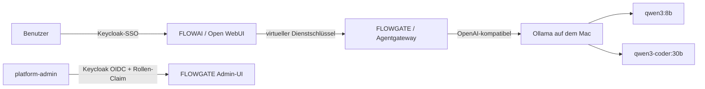

# FLOWGATE / Agentgateway administrieren

FLOWGATE ist die zentrale Modellschicht zwischen FLOWAI und dem lokalen
Ollama. Eingesetzt wird Agentgateway 1.7 unter Apache-2.0-Lizenz. Die
Benutzeroberfläche ist unter <http://localhost:4001/ui/> erreichbar und wird
mit Keycloak geschützt.

## Implementierter Datenweg



FLOWAI besitzt keinen direkten Ollama-Zugang. Es ruft intern
`http://agentgateway:4000/v1` auf. FLOWGATE prüft den virtuellen Schlüssel und
erlaubt diesem Dienstkonto ausschließlich die beiden deklarierten Qwen-
Modelle. Der Modellendpunkt wird nicht auf dem Host veröffentlicht.

Die Admin-Oberfläche läuft getrennt auf Port 4001. Agentgateway führt dort den
OIDC-Code-Flow selbst aus. Nur ein ID-Token mit der Realm-Rolle
`platform-admin` erfüllt die serverseitige Autorisierungsregel. Der gemeinsame
9-Punkte-Launcher wird anschließend durch die Unternehmens-Shell ergänzt.

## Start und Funktionstest

```bash
ollama list
make ai-gateway
make webui
```

Danach prüfen:

1. <http://localhost:4001/ui/> öffnen. Keycloak muss die Anmeldung übernehmen.
2. Mit `demo01` anmelden. Das Konto erbt `platform-admin` aus der simulierten
   AD-Gruppe und darf FLOWGATE öffnen.
3. Unter **LLM > Models** müssen `qwen3:8b` und `qwen3-coder:30b` erscheinen.
4. FLOWAI unter <http://localhost:3001> öffnen, `qwen3:8b` wählen und eine
   Testfrage stellen.
5. Ein Aufruf ohne gültigen virtuellen Schlüssel muss am Modellendpunkt mit
   `401 Unauthorized` abgewiesen werden.

## Konfiguration

| Datei / Variable | Zweck |
|---|---|
| `deployment/agentgateway/config.yaml` | Modelle, strikte Schlüsselprüfung, OIDC und Admin-Rolle |
| `AGENTGATEWAY_OLLAMA_BASE_URL` | Ollama-Endpunkt, lokal standardmäßig `host.docker.internal:11434/v1` |
| `AGENTGATEWAY_OPENWEBUI_KEY` | virtueller, auf FLOWAI begrenzter Dienstschlüssel |
| `AGENTGATEWAY_OIDC_CLIENT_SECRET` | Geheimnis des Keycloak-Clients `agentgateway-ui` |
| `AGENTGATEWAY_OIDC_COOKIE_SECRET` | 32 zufällige Bytes als 64 Hex-Zeichen für Sitzungs-Cookies |
| `AGENTGATEWAY_SESSION_KEY` | separater Schlüssel für verschlüsselte Gateway-Sitzungs-IDs |
| `AGENTGATEWAY_UI_PUBLIC_URL` | öffentliche Basis-URL der FLOWGATE-Administration |

Der Keycloak-Issuer bleibt die browserseitige URL. Token- und JWKS-Endpunkt
werden intern über den Compose-Dienst `keycloak` erreicht. Dadurch stimmen
Issuer-Prüfung und Browser-Redirect überein, obwohl Gateway und Keycloak in
Containern laufen.

## Identitätsgrenze

Open WebUI meldet sich derzeit mit einem technischen virtuellen Schlüssel am
Gateway an. FLOWGATE sieht deshalb für Modellaufrufe den Verbraucher
`open-webui`, nicht automatisch die einzelne Keycloak-Identität des
Chatbenutzers. Benutzerrechte für Chat und MCP-Werkzeuge werden weiterhin am
FLOWAI-Proxy sowie in den Fachwerkzeugen erzwungen.

Für personenbezogene Budgets, Kostenstellen oder Modellrechte pro Benutzer
muss FLOWAI künftig das Benutzer-Token weiterreichen oder pro Benutzer einen
kurzlebigen Gateway-Schlüssel beziehen. Erst dann dürfen Gateway-Auswertungen
als personenbezogene Nutzungsauswertung behandelt werden.

## Livebetrieb

Vor einer Netzfreigabe:

- Demo-Schlüssel in `.env` durch Geheimnisse aus einem Secret Store ersetzen;
- ausschließlich TLS-Adressen in Keycloak und FLOWGATE registrieren;
- Admin-Port und internen Modellport per Firewall trennen;
- Schlüssel nur gehasht speichern beziehungsweise regelmäßig rotieren;
- Modell-, Token- und Kostenbudgets je Dienst oder Benutzer festlegen;
- Protokolle ohne Prompt-Inhalte betreiben oder Aufbewahrung und Datenschutz
  ausdrücklich freigeben;
- negative Rollen-, Schlüssel- und Modelltests in die Abnahmetests aufnehmen;
- Konfiguration, Keycloak-Client und Gateway-Daten sichern und Restore testen.

