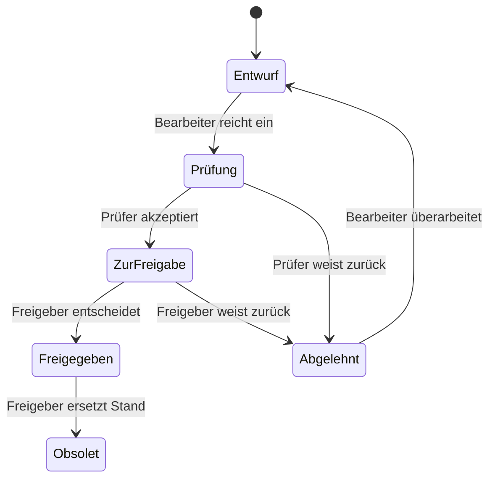

# Paperless-ngx administrieren

## Komponenten und automatischer Start

Das Profil `full` umfasst Paperless-ngx, PostgreSQL, Redis und drei einmalige
Seed-Dienste. `paperless-governance-seed` legt zuerst Rollen, Metadaten,
Projekträume und Freigabeworkflows an. `paperless-reporting-seed` erzeugt danach
die read-only Termin-View für Grafana. Erst anschließend stellt
`paperless-seed` die sieben Demo-PDFs in den Consume-Ordner. Dadurch gelten die
Zugriffsregeln schon beim Import.

```bash
docker compose --profile full up -d paperless-webserver paperless-shell paperless-governance-seed paperless-reporting-seed paperless-seed
curl --fail http://localhost:8010/api/health/
docker compose logs --tail=200 paperless-shell paperless-governance-seed paperless-reporting-seed paperless-seed
```

Port 8010 wird von `paperless-shell` veröffentlicht. Die Shell reicht API,
Uploads, Downloads und WebSocket-Verbindungen an `paperless-webserver` weiter
und ergänzt ausschließlich in HTML-Seiten den gemeinsamen
linke Unternehmensleiste mit eingebettetem 9-Punkte-App-Launcher. Paperless
bleibt für Anmeldung und Dokumentrechte
verantwortlich.

Die Governance-Quelle ist
`deployment/paperless/governance.json`. Der Seed ist wiederholbar, aktualisiert
gleichnamige verwaltete Objekte und löscht keine unbekannten Gruppen,
Dokumente oder Workflows.

```bash
make seed-dms
```

`paperless-iam-seed` synchronisiert anschließend die 51 Keycloak-Identitäten.
Dabei werden nicht nur direkt am Benutzer eingetragene Realm-Rollen, sondern
auch die über `AD-GG-FLOW-*`-Gruppen geerbten Rollen ausgewertet. Das ist
wichtig, weil `demo01` seinen Vollzugriff absichtlich aus
`AD-GG-FLOW-PLATFORM-ADMIN` erhält. Für den geführten Rundgang wird dieses
Konto in Paperless als `staff` und `superuser` vorprovisioniert; Fachkonten
erhalten ausschließlich die aus ihrer Rollen- und Projektmatrix berechneten
Gruppen.

Nach jeder Änderung am IAM-Seed werden mindestens Anmeldung, App-Laden und der
vormals kritische UI-Endpunkt geprüft:

```text
GET /api/ui_settings/ → 200 für demo01
```

Ein `403` an dieser Stelle bedeutet meist, dass Gruppenrollen bei der
Synchronisation nicht aufgelöst wurden oder eine alte Paperless-Zuordnung noch
nicht aktualisiert ist. `make seed-dms` ist idempotent und kann zur Korrektur
erneut ausgeführt werden.

## Zweidimensionales Berechtigungsmodell

Ein Benutzer benötigt immer zwei Gruppenzuordnungen:

1. Eine **Funktionsrolle** erteilt globale Paperless-Aktionen.
2. Eine **Zugriffsgruppe** erteilt Rechte auf konkrete Dokumente.

Nur wenn beide Ebenen zusammenpassen, erscheint das Dokument und ist die
jeweilige Aktion erlaubt. Das Ausblenden in der Oberfläche ist nicht die
Sicherheitsgrenze; Paperless prüft die Objektberechtigung serverseitig.

| Funktionsrolle | Globale Befugnis | Nicht enthalten |
|---|---|---|
| `DMS-Leser` | erlaubte Dokumente und Metadaten lesen | Import, Änderung, Löschung |
| `DMS-Bearbeiter` | importieren, Metadaten pflegen, Notizen und Entwürfe ändern | finale Freigabe |
| `DMS-Pruefer` | Dokumente im Prüfschritt bewerten und zurückweisen | finale Freigabe |
| `DMS-Freigeber` | Freigabe, Ablehnung und Obsoletsetzung | Benutzer-/Systemverwaltung |
| `DMS-Administration` | Gruppen, Metadaten und Workflows verwalten | tägliche fachliche Freigabe |

Zugriffsgruppen sind `DMS-Eingang`, die vorbereiteten Bereichsgruppen und pro
Projekt vier getrennte Gruppen:

```text
DMS-Projekt-KOM-2027-4711-Lesen
DMS-Projekt-KOM-2027-4711-Bearbeiten
DMS-Projekt-KOM-2027-4711-Pruefen
DMS-Projekt-KOM-2027-4711-Freigeben
```

Beispiele:

- Sachbearbeiter: `DMS-Bearbeiter` plus Projektgruppe `...-Bearbeiten`.
- Qualitätsprüfer: `DMS-Pruefer` plus Projektgruppe `...-Pruefen`.
- Freigabeverantwortlicher: `DMS-Freigeber` plus Projektgruppe
  `...-Freigeben`.
- Reiner Projektleser: `DMS-Leser` plus Projektgruppe `...-Lesen`.

Geschützte Personaldokumente verwenden statt Projektgruppen
`DMS-Bereich-HR-Recruiting` oder `DMS-Bereich-HR-Payroll`. Die
Klassifizierungsworkflows setzen `Vertraulich/Personal`, verschieben in den
Personalpfad und entziehen `DMS-Eingang`. Die beiden Gruppen dürfen nicht
pauschal gemeinsam vergeben werden.

!!! warning "Vier-Augen-Prinzip"
    Derselbe reale Benutzer darf in einem Projekt nicht gleichzeitig
    `...-Pruefen` und `...-Freigeben` erhalten. Superuserkonten sind nur für
    Notfalladministration beziehungsweise die geführte lokale Demo zu
    verwenden. Die IAM-Demokonten werden reproduzierbar aus dem Keycloak-Seed
    synchronisiert; ihre bekannten Demo-Passwörter sind niemals für eine
    erreichbare Staging- oder Produktionsumgebung zulässig.

## Projektvorlagen

Die Datei enthält die Vorlagen `Kundenkommission`, `Interne Fertigung` und
`Entwicklungsprojekt`. Eine Instanz erzeugt Projekt-Tag, Ablagepfad, vier
Zugriffsgruppen, Eingangsregeln und alle Statusübergänge. Die vier ERP-Projekte
`KOM-2027-4711` und `KOM-2027-1001` bis `KOM-2027-1003` sind bereits
instanziiert.

Ein weiteres Projekt wird ohne Codeänderung angelegt:

```bash
make seed-dms-project \
  TEMPLATE="Kundenkommission" \
  CODE="KOM-2027-5001" \
  NAME="Beispielkunde Anlage 1"
```

Der Standard erkennt Dateinamen mit dem Projektcode. Zusätzliche Muster lassen
sich direkt angeben:

```bash
docker compose --profile full run --rm paperless-governance-seed \
  --config /config/governance.json \
  --project-template "Entwicklungsprojekt" \
  --project-code "ENTW-2027-17" \
  --project-name "Neue Steuerung" \
  --filename-pattern "*ENTW-2027-17*" \
  --filename-pattern "*SCU-NG*"
```

Ein einmalig per Kommando erzeugtes Projekt bleibt in Paperless erhalten. Für
reproduzierbare Umgebungen wird die Instanz zusätzlich unter `projects` in der
Governance-Datei versioniert.

## Freigabeworkflow



Beim Übergang auf **In Prüfung** verliert die Bearbeitungsgruppe ihr
Änderungsrecht. Bei **Zur Freigabe** kann nur noch die Projekt-Freigabegruppe
ändern. Eine direkte Freigabe aus Entwurf, Prüfung oder Ablehnung wird durch
einen Schutzworkflow entfernt. Freigegebene Dokumente bleiben für alle
Projekt-Lesegruppen sichtbar; Änderungen und Obsoletsetzung bleiben beim
Freigeber und der Administration.

`Freigegeben durch` und `Freigabedatum` sind Pflichtmetadaten der fachlichen
Arbeitsanweisung. Zusätzlich hält die Paperless-Dokumenthistorie Benutzer und
Zeitpunkt fest. Vor produktivem Einsatz ist ein negativer Berechtigungstest mit
je einem getrennten Bearbeiter-, Prüfer-, Freigeber- und Fremdprojektkonto
durchzuführen.

## Terminmetadaten und Grafana-Reporting

Die Governance legt zusätzlich Meilenstein, Lieferobjekt, Verantwortung,
Baseline-Version und -Termin, aktuellen Liefertermin, Forecast,
tatsächliche Lieferung, Empfänger, Vertragskennzeichen, Fortschritt und
Terminnotiz als Custom-Fields an. Diese Felder werden im DMS gepflegt; Grafana
ist ausschließlich die Lese- und Auswertungsschicht.

`paperless-reporting-seed` legt idempotent
`reporting.dms_document_schedule` und die Rolle `grafana_reader` an. Bei jedem
Lauf wird deren Passwort auf `GRAFANA_PAPERLESS_DB_PASSWORD` gesetzt. Die Rolle
hat keinen Zugriff auf Paperless-Tabellen, OCR-Inhalte oder Dateien, sondern nur
`SELECT` auf die Reporting-View.

```bash
make dms-dashboard
docker compose logs --tail=200 paperless-reporting-seed grafana
```

Der gemeinsame SQL-Account bildet keine individuellen Paperless-ACLs ab. Den
Grafana-Ordner daher im PoC nur der zentralen Projektleitung beziehungsweise
dem Management geben. Eine projektgenaue Freigabe benötigt getrennte Views
oder einen API-Proxy mit Benutzerkontext; siehe
[Grafana-Administration](grafana.md#berechtigungsgrenze).

## Demo-Dokumente und erneuter Import

Die sieben Repository-PDFs werden über `paperless-seed-state` nur einmal
eingeliefert. Der Governance-Seed setzt Dokumenttyp, Fachmetadaten, Status und
die passende Projekt- oder Personal-ACL. Bei einem bestehenden v1-Seed werden
ausschließlich das fiktive Bewerbungsprofil und die Musterabrechnung
nachgeliefert.

Falls ein alter Stack Duplikate enthält, zeigt das folgende Skript zuerst nur
eine Vorschau. `--confirm` löscht ausschließlich weitere Kopien der sieben
bekannten Demodateien und behält jeweils das älteste Dokument.

```bash
docker compose --profile full run --rm --no-deps \
  -v "$PWD/scripts/dedupe_paperless_demo.py:/dedupe.py:ro" \
  dms-mcp python /dedupe.py
```

## Produktive Kontrollen

- Demo-Passwort und `PAPERLESS_SECRET_KEY` vor gemeinsamer Nutzung ersetzen.
- Benutzer über Unternehmens-IAM synchronisieren; keine geteilten Konten.
- DMS-MCP mit eigenem `DMS-Leser`-Servicekonto und nur den erforderlichen
  Projekt-Lesegruppen betreiben, niemals mit dem Admin-Fallback.
- Gruppenänderungen, Workflowänderungen, Freigaben und Massenänderungen in das
  zentrale Audit- und Alarmierungskonzept aufnehmen.
- Aufbewahrung, Löschsperren, Datenschutz, Export und Restore fachlich testen.
- Nach Paperless-Updates `make seed-dms`, Unit-Tests, einen kompletten
  Statusdurchlauf und negative Sichtbarkeitstests ausführen.

## Backup und Wiederherstellung

Konsistent zu sichern sind `paperless-db-data`, `paperless-data`,
`paperless-media` und bei Bedarf `paperless-export`. Der Consume-Ordner ist
eine Eingangsqueue, kein Archiv. Nach Wiederherstellung sind OCR, Original,
Metadaten, Projekt-ACL, Statusworkflow und stabile Dokument-ID stichprobenartig
zu prüfen.
