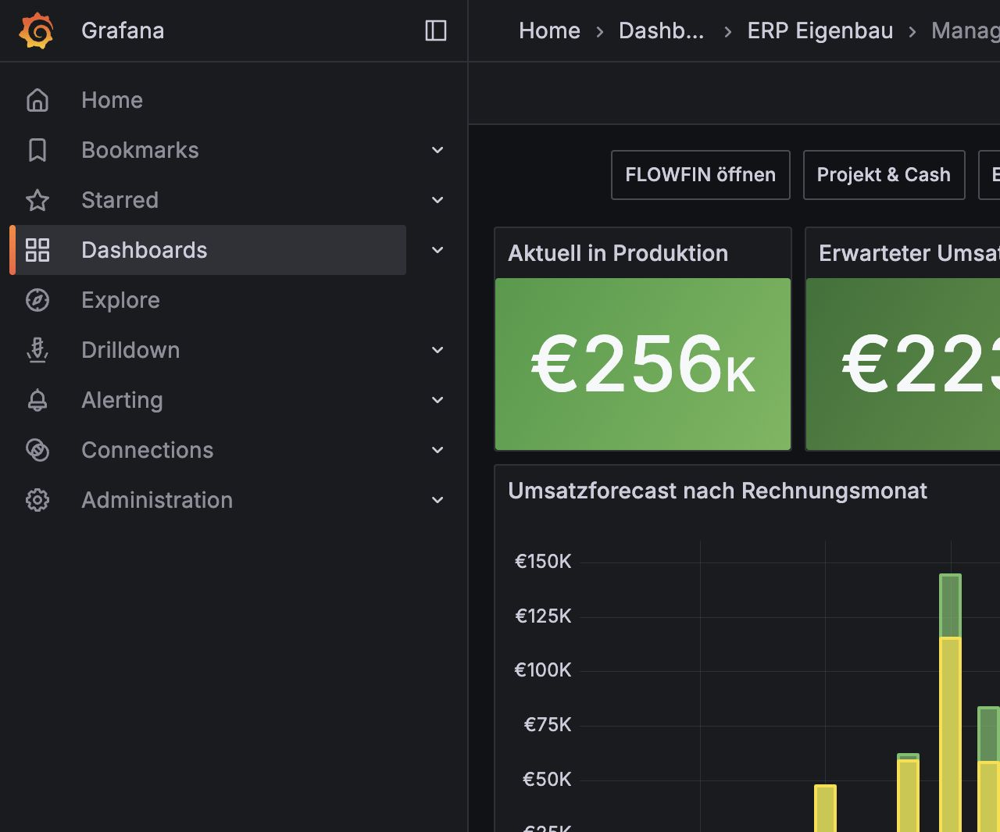

# Grafana-Dashboards nutzen

Grafana stellt technische Betriebsdaten und freigegebene Prozesskennzahlen dar.
Es ersetzt weder Paperless als führendes DMS noch ERPNext-Belege oder
Qualitätsnachweise.

## Management-Dashboards öffnen

1. `make management-dashboard` starten.
2. [Management – Executive Cockpit](http://localhost:3000/d/management-executive)
   öffnen.
3. Für laufende Aufträge, Fortschritt und aktuellen Arbeitsgang zu
   [Management – Fertigung & Arbeitsgänge](http://localhost:3000/d/management-production-live)
   wechseln.
4. Für Opportunities der nächsten Jahre zu
   [Management – CRM-Pipeline 2027–2031](http://localhost:3000/d/management-crm-pipeline)
   wechseln.
5. Für Profitabilität und Liquidität zu **Management – Projekte & Cash**
   wechseln.
6. Für F&E-, Software-, Qualitäts- und Gewährleistungskosten zu
   **Management – Engineering & Qualität** wechseln.

Das Executive Cockpit zeigt insbesondere den Brutto-Auftragswert der aktuell
in Produktion oder Endprüfung befindlichen Aufträge und den mit der gepflegten
Wahrscheinlichkeit gewichteten erwarteten Umsatz. Die Dashboards sind read-only;
Forecasts und interne Finanzvorgänge werden in
[FLOWFIN](../../user-guides/finance.md) gepflegt.

Das Fertigungsdashboard zeigt je aktivem Work Order den aktuellen oder nächsten
ausführbaren Arbeitsgang, Arbeitsplatz, zugeordneten Mitarbeiter,
Arbeitsgangfortschritt, Liefertermin und Risiko. Ein blockierter Arbeitsgang
hat Vorrang vor lediglich wartenden Folgeschritten. Die Arbeitsplatzsicht
verdichtet außerdem offene Vorgänge und verbleibende Planminuten.

Das CRM-Dashboard trennt Brutto- und wahrscheinlichkeitsgewichtete Pipeline,
gruppiert sie nach Abschlussjahr und Vertriebsphase und listet die einzelnen
Opportunities mit Kunde, Produkt, Owner, Quelle und Region. Die Demodaten decken
2027 bis 2031 ab; ein Forecast ist keine Auftragserteilung.

!!! info "Demo-Snapshot"
    Die aktuellen Tabellenwerte stammen aus einem reproduzierbaren Demo-Snapshot.
    Für Livebetrieb muss die in der
    [Reporting-Schnittstelle](../../interfaces/finance-reporting.md) beschriebene
    inkrementelle Beladung aus den Quellsystemen aktiviert werden.

## Dokumentenlieferplan öffnen

1. `make dms-dashboard` starten, falls Grafana noch nicht läuft.
2. [DMS – Dokumentenlieferplan](http://localhost:3000/d/dms-document-deliveries/dms-e28093-dokumentenlieferplan)
   öffnen und mit dem persönlichen Grafana-Konto anmelden.
3. Oben das gewünschte **Projekt** beziehungsweise die Kommission wählen.
4. Kennzahlen, Wochenverteilung und Terminstatus prüfen.
5. In der Tabelle auf den Dokumenttitel klicken, um den Datensatz direkt in
   Paperless zu öffnen. Änderungen werden ausschließlich dort vorgenommen.

Das Dashboard zeigt pro Projekt:

- Gesamtzahl der Dokumentlieferobjekte, gelieferte und überfällige Dokumente,
- in den nächsten 14 Tagen fällige sowie durch den Forecast gefährdete Termine,
- Verteilung der Liefertermine nach Kalenderwoche,
- Baseline, aktuellen Liefertermin, Forecast und Ist-Lieferung,
- Meilenstein, Fortschritt, Verantwortung und Lieferempfänger.

## Termine richtig lesen

| Feld | Bedeutung | Änderungsregel |
|---|---|---|
| Baseline-Version | Kennung des genehmigten Planstands, z. B. `BL-01` | nur bei formeller Neu-Baseline ändern |
| Baseline-Termin | eingefrorener Vergleichstermin dieses Planstands | nicht bei jeder Verschiebung überschreiben |
| Liefertermin | aktuell vereinbarter Solltermin | nach genehmigter Terminänderung pflegen |
| Forecast-Termin | realistische aktuelle Prognose | regelmäßig aktualisieren; ändert die Baseline nicht |
| Tatsächliches Lieferdatum | nachweisbares Ist-Datum der Lieferung | erst nach erfolgter Lieferung setzen |

Der Status wird automatisch abgeleitet:

| Status | Regel |
|---|---|
| Geliefert | tatsächliches Lieferdatum ist gesetzt |
| Überfällig | Liefertermin liegt in der Vergangenheit, Ist fehlt |
| Gefährdet | Forecast liegt nach dem Liefertermin |
| Fällig ≤ 14 Tage | noch offen und innerhalb der nächsten 14 Tage fällig |
| Im Plan | offen, terminiert und ohne erkannte Gefährdung |
| Ohne Termin | Projekt ist gepflegt, aber der Liefertermin fehlt |
| Obsolet | Dokument trägt den DMS-Status `Status/Obsolet` |

Die Differenz **Δ Baseline** zeigt die genehmigte Verschiebung gegenüber dem
eingefrorenen Plan. **Δ Forecast** zeigt die aktuell erwartete Abweichung vom
gültigen Liefertermin.

!!! info "Planungseintrag vor dem fertigen Dokument"
    Das Dashboard liest Paperless-Dokumentdatensätze. Für ein künftig
    geschuldetes Dokument muss deshalb bereits ein kontrollierter Entwurf im
    DMS existieren und vollständig terminiert sein. Eine leere Zeile ohne
    Dokumentdatensatz kann Paperless nicht darstellen. Für sehr große
    Vertragsdokumentenlisten ist langfristig ein separates
    Dokumentlieferregister mit DMS-Verknüpfung sinnvoll.

## Technische Dashboards lesen

1. Dashboard und Zeitraum prüfen; für einen aktuellen Vorfall einen kurzen,
   für Trends einen längeren Zeitraum wählen.
2. Filter wie Umgebung, Service oder Auftrag setzen.
3. Bei einem Ausschlag den Zeitpunkt mit Prozessereignissen in ERPNext bzw.
   Portal vergleichen.
4. Alarmstatus bestätigen und den hinterlegten Runbook-Link verwenden.

Ein grünes Dashboard ist keine fachliche Freigabe. Für Dokumentstatus,
Auftrag, Qualität, Lieferung und Rechnung zählen die Datensätze im jeweils
führenden System.
