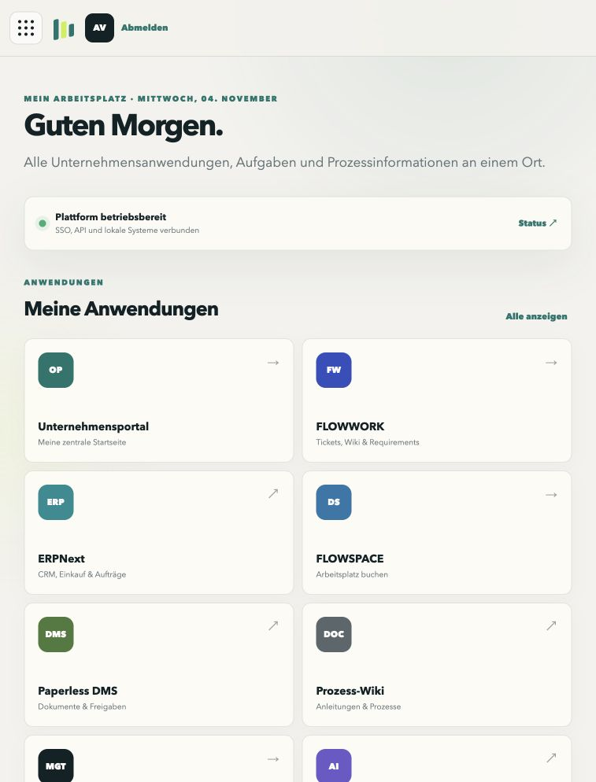
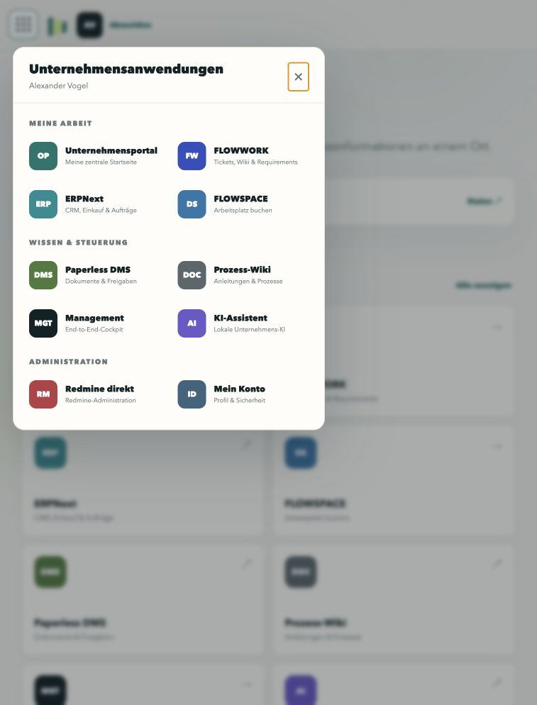

# Unternehmensportal und App-Launcher

Das Unternehmensportal unter `http://localhost:8088` ist der gemeinsame
Einstieg in die Plattform. Es ersetzt keine Fachanwendung, sondern zeigt die
für den angemeldeten Benutzer freigegebenen Anwendungen, Schnellaktionen,
aktuelle Projektarbeit und ein persönliches KI-Tagesbriefing.

## Mein KI-Arbeitsplatz

Der erste Bereich im Portal führt Aufgaben, Termine und Risiken aus den
freigegebenen Systemen rollenabhängig zusammen. Der Einkauf sieht zum Beispiel
Liefertermintreue und verspätete Bestellungen. Entwicklung und Engineering
sehen eigene Tickets, Requirements und Reviewhinweise. Jede Fokusaktion kann
direkt im Fachsystem geöffnet oder mit FLOWAI besprochen werden.

Die Demo startet mit
[Felix Hoffmann im Einkauf](http://localhost:8088/?user_id=USR-006&date=2026-11-05).
Über **Demoprofil** kann unmittelbar auf Helena Friedrich, Produktion,
Qualität, HR, Finanzen oder andere Rollen gewechselt werden. Der Livebetrieb
leitet das Profil aus der Keycloak-Identität ab.

Details zu Agenten, MCP-Abdeckung und Sicherheitsgrenzen enthält der
[Leitfaden zum persönlichen KI-Arbeitsplatz](future-workplace.md).

## Management-Zielbild Arbeitsplatz 2028

FLOWMANAGE ergänzt die persönliche Sicht um ein 12- bis 24-Monats-Szenario.
Es zeigt, welche Standardfälle Agenten innerhalb klarer Grenzen übernehmen,
welche Aktionen der Mensch bestätigt und welche Entscheidungen dauerhaft
menschliche Verantwortung benötigen. Eine Entscheidungs-Inbox, ein
Agentenregister und die Autonomiestufen A0 bis A4 machen die Arbeitsteilung
konkret und überprüfbar.

[Arbeitsplatz 2028 im Management-Cockpit öffnen](http://localhost:8088/management#future-model)

## Einstieg

1. Portal öffnen und über Keycloak anmelden.
2. Unter **Meine Anwendungen** eine Fachanwendung wählen.
3. Alternativ links oben die **neun Punkte** anklicken. Derselbe Launcher ist
   in jeder Benutzeroberfläche verfügbar: FLOWPORTAL, FLOWMANAGE, FLOWWORK,
   FLOWERP, FLOWMES, FLOWHR, FLOWSPACE, FLOWDOC, FLOWDOCS, FLOWFIN,
   FLOWINSIGHT, FLOWAI, FLOWGATE, FLOWTASK, FLOWID, FLOWAPI und FLOWOPS.
4. Externe Anwendungen werden in einem neuen Tab geöffnet; interne Module
   bleiben in der Plattformoberfläche.

## Rollenbasierte Anzeige

Der Launcher wertet die Realm-Rollen aus dem Keycloak-Login aus.

| Rolle | Sichtbare Anwendung |
|---|---|
| `work-user` | FLOWWORK Aufgaben und Wiki |
| `requirements-user` | FLOWWORK Requirements und Traceability |
| `production-user` | FLOWMES |
| `hr-user` / `hr-admin` | FLOWHR |
| `desksharing-user` | FLOWSPACE |
| `management-user` | FLOWMANAGE und FLOWFIN |
| `dms-user` | FLOWDOC |
| `platform-admin` | zusätzlich FLOWGATE-Modellverwaltung und alle Anwendungen |

Eine ausgeblendete Kachel ist keine alleinige Sicherheitsmaßnahme. Jeder
interne Seiten- und API-Aufruf wird serverseitig nochmals gegen dieselben
Rollen geprüft.

Die externen Produkte bleiben eigenständige Fachanwendungen. Eine schlanke
Unternehmens-Shell ergänzt dort dauerhaft eine 76 Pixel breite linke
Navigationszone nach dem Muster von FLOWWORK und FLOWMES. Launcher,
Produktkennung, Schnellnavigation, Online-Status, Farben und Typografie sind
damit nicht mehr schwebend aufgesetzt, sondern Teil des Seitenrasters. Login,
Objektberechtigungen, Beleglogik und Dokumentzugriff werden weiterhin vom
jeweiligen Fachsystem geprüft.

## Gemeinsames Erscheinungsbild

| Element | Standard |
|---|---|
| Navigation | Navy `#08141a` |
| Primäraktion | Petrol `#008b80` |
| Hervorhebung | Lime `#c9ee45` |
| Arbeitsfläche | Hellgrau `#eef1ef` |
| Karten | Weiß `#ffffff` |
| Text | Dunkelblau `#12262d` |

Produktspezifische Fachmasken bleiben erkennbar. Die gemeinsame Shell legt
bewusst keine Berechtigungen oder Formlogik über die Originalanwendung.

## Suche und Schnellstart

Die Suche filtert die Anwendungsübersicht. Die Schnellaktionen führen direkt
zum Anlegen eines Tickets oder Requirements, zur Dokumentenablage sowie zur
Zeit- und Abwesenheitsbuchung. Der Abschnitt **Vom Bedarf bis zur Lieferung**
ordnet die Werkzeuge dem Gesamtprozess zu.

Im Demo-Modus sind alle Kacheln sichtbar. Mit `make sso` ist das Portal nur
nach Keycloak-Anmeldung erreichbar und zeigt ausschließlich freigegebene
Anwendungen.

## Einheitliche Produktnamen

| Produktname | Technische Basis | Zweck |
|---|---|---|
| FLOWPORTAL | FastAPI/HTML | zentraler Einstieg |
| FLOWMANAGE | FastAPI/HTML | Management-Cockpit und geführte Demo |
| FLOWERP | ERPNext/Frappe | CRM, Einkauf, Fertigung, Lager und Finanzen |
| FLOWWORK / FLOWTASK | FastAPI / Redmine | Requirements, Traceability, Tickets und Wiki |
| FLOWMES | FastAPI/HTML | Shopfloor, Zeiten, Material und Qualität |
| FLOWDOC / FLOWDOCS | Paperless-ngx / MkDocs | Dokumentenlenkung und Prozesswissen |
| FLOWHR / FLOWSPACE | FastAPI/HTML | Personalprozesse und Desksharing |
| FLOWFIN / FLOWINSIGHT | FastAPI / Grafana | Finanzprozesse und Dashboards |
| FLOWAI | Open WebUI | lokale, quellenbasierte KI |
| FLOWGATE | Agentgateway/Ollama | Modellrouting, virtuelle Schlüssel und Richtlinien |
| FLOWID | Keycloak | Identitäten, Rollen und SSO |
| FLOWAPI / FLOWOPS | OpenAPI / Prometheus | Integration, Migration und Betrieb |
