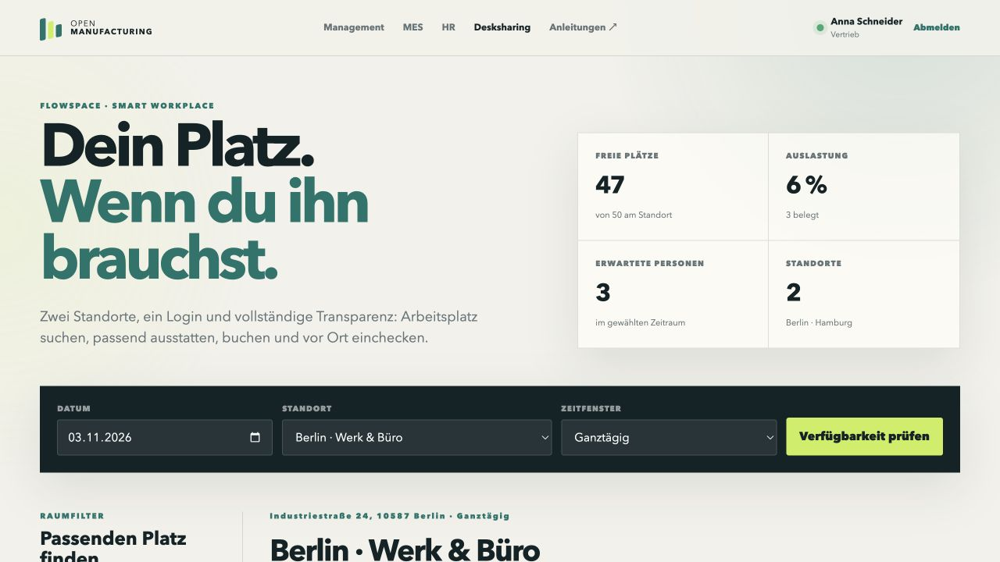
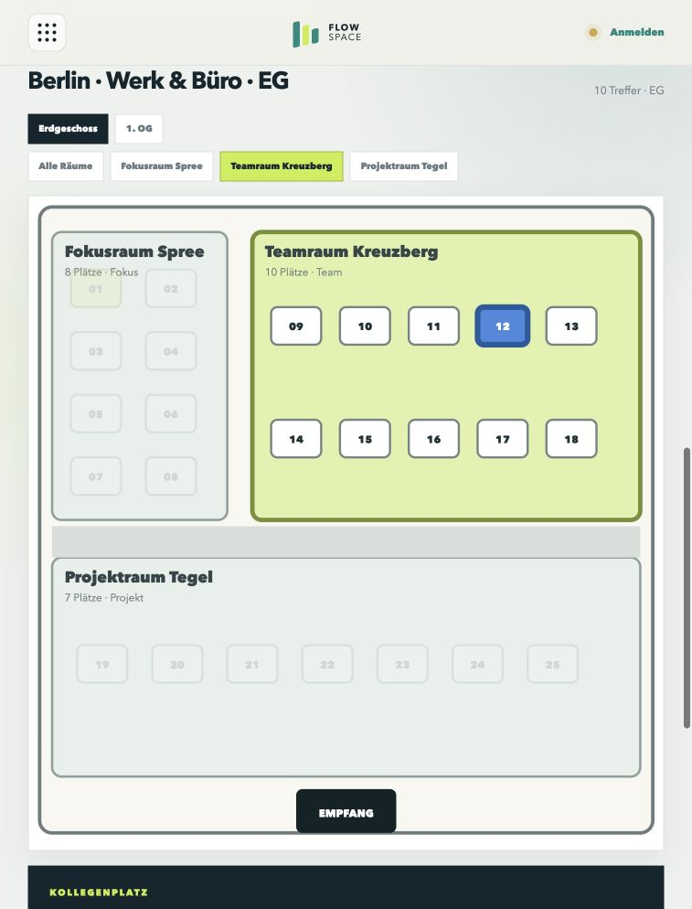

# FLOWSPACE Desksharing

FLOWSPACE ist die gemeinsame Arbeitsplatzbuchung der Plattform. Der Demostand
enthält zwei Standorte mit jeweils 50 Plätzen und nutzt dieselben 50
Beispielidentitäten wie Keycloak.

| Standort | Adresse | Etagen | Plätze |
|---|---|---:|---:|
| Berlin · Werk & Büro | `BER-01`, Industriestraße 24, 10587 Berlin | EG, 1. OG | 50 |
| Hamburg · Projektbüro | `HAM-01`, Am Sandtorkai 18, 20457 Hamburg | EG, 1. OG | 50 |

Jede Etage besitzt einen Fokusraum, einen Teamraum und einen Projektraum. Der
interaktive Gebäudeplan zeigt die tatsächliche Raumaufteilung, Flur, Empfang
beziehungsweise Aufzug sowie jeden buchbaren Arbeitsplatz.

## Arbeitsplatz buchen

1. [FLOWSPACE öffnen](http://localhost:8088/desksharing).
2. Im Demo-Modus den gewünschten Beispielbenutzer wählen. Bei aktivem SSO
   stammt die Person automatisch aus Keycloak; die Auswahl ist dann verborgen.
3. Datum, Standort und Zeitfenster **Ganztägig**, **Vormittag** oder
   **Nachmittag** wählen und **Verfügbarkeit prüfen**.
4. Die gewünschte Etage und danach einen Raum direkt im Gebäudeplan oder über
   die Raumleiste auswählen.
5. Optional nach Fokus-/Team-/Projektzone, höhenverstellbarem Tisch,
   barrierearmem Platz oder Dual-Monitor filtern.
6. Einen weißen, freien Platz im Plan anklicken, Ausstattung und Raum prüfen,
   optional eine Notiz eingeben und **Verbindlich buchen**.

Farben im Raumplan:

- Weiß: im gewählten Zeitfenster frei.
- Limette: eigene aktive Buchung.
- Grau: durch eine andere Person belegt.
- Blau: gesuchter Kollege.

Das System verhindert sowohl die Doppelbelegung eines Platzes als auch zwei
überlappende Arbeitsplatzbuchungen derselben Person. Vormittag und Nachmittag
können dagegen von zwei verschiedenen Personen genutzt werden.

## Kollegen im Grundriss finden

1. Datum, Standort und Zeitfenster einstellen.
2. Im linken Bereich **Kollegen finden** wählen.
3. Einen Namen oder eine Abteilung eingeben, beispielsweise
   `Felix Hoffmann`.
4. Den Treffer anklicken. FLOWSPACE öffnet automatisch die richtige Etage und
   den richtigen Raum und markiert den Arbeitsplatz blau.
5. Rechts Etage, Raum, Arbeitsplatz und Buchungszeitraum ablesen.

Die direkte Demo ist unter
[Berlin, Teamraum Kreuzberg und Felix Hoffmann](http://localhost:8088/desksharing?date=2026-11-05&site=BER&floor=EG&room=BER-EG-TEAM&colleague=Felix%20Hoffmann)
vorbereitet. Die Suche zeigt ausschließlich Personen mit aktiver Buchung im
gewählten Zeitraum. Für den Livebetrieb sind zusätzlich individuelle
Sichtbarkeit, Betriebsvereinbarung, Datenschutzinformation, Löschfrist und
ein optionales Opt-out festzulegen.

## Ankommen, auschecken oder stornieren

Unter **Meine Buchungen** stehen je nach Status folgende Aktionen bereit:

| Status | Aktion | Ergebnis |
|---|---|---|
| Gebucht | Einchecken | Platz wird als anwesend geführt |
| Gebucht / Eingecheckt | Stornieren | Platz wird wieder freigegeben |
| Eingecheckt | Auschecken | Buchung ist abgeschlossen |

Alle Änderungen werden mit Identität, Zeitpunkt, Buchungs- und Arbeitsplatz-ID
im Desksharing-Audit protokolliert. Ein Desksharing-Administrator darf
Buchungen im Ausnahmefall für andere Personen stornieren.

## Demokonten

Die regulären Konten heißen `demo01` bis `demo50`. Das gemeinsame lokale
Demopasswort steht in der [Keycloak-Benutzeranleitung](../tools/user/keycloak.md).
Die Konten sind auf Abteilungen, Standorte und Fachrollen verteilt. Zum Testen:

| Konto | Beispielrolle | Heimatstandort |
|---|---|---|
| `demo01` | Vertrieb | Berlin |
| `demo16` | Produktion | Berlin |
| `demo31` | Lager | Hamburg |
| `demo36` | HR-Administration | Hamburg |
| `demo49` | IT und Desksharing-Administration | Hamburg |

Die Konten sind ausschließlich fiktive lokale Testdaten.
