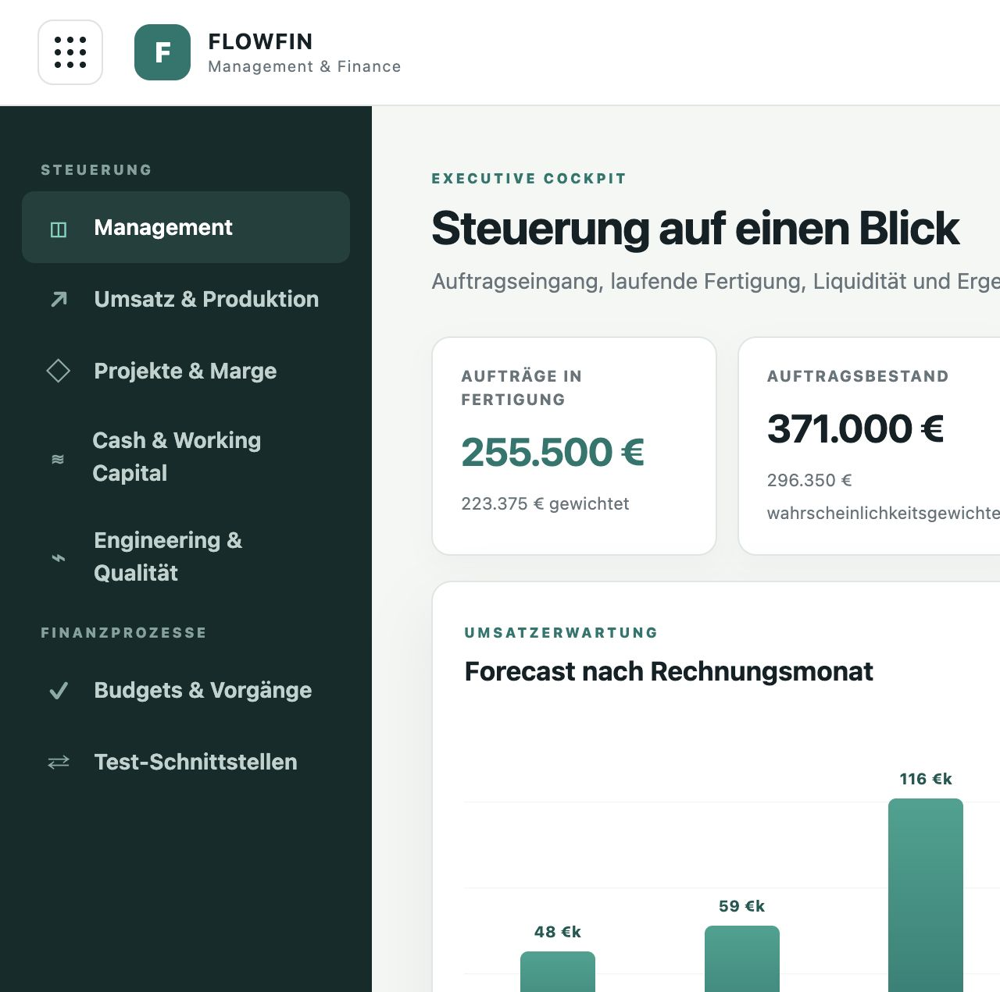

# FLOWFIN: Management und Finanzen

FLOWFIN bündelt die wichtigsten Managementkennzahlen eines produzierenden
Hardware-/Software-Unternehmens. Es ergänzt ERPNext und Grafana, ersetzt aber
keine rechtskonforme Finanzbuchhaltung. Interne Vorgänge wie Budget-Forecast,
Auslagenfreigabe und Anlagenstamm sind funktionsfähig; DATEV, Bank und
E-Rechnung laufen ausdrücklich als Testadapter ohne externe Übertragung.

## Öffnen und Rollen

- Oberfläche: [http://localhost:8088/finance](http://localhost:8088/finance)
- Rolle: `finance-user` oder `management-user`; `platform-admin` hat Vollzugriff.
- Grafana-Detaildashboards: `make management-dashboard`, danach
  [Executive Cockpit](http://localhost:3000/d/management-executive)

Jede Kennzahl trägt in der Demo den Datenstatus **DEMO**. Ein Testlauf bei einer
externen Schnittstelle trägt zusätzlich `mode=test` und `transmitted=false`.



## Management-Dashboards

| Ansicht | Aussage | Führende Produktivquelle |
|---|---|---|
| Management | Auftragsbestand, erwarteter Produktionsumsatz, EAC-Marge, Liquidität und Risiken | ERPNext + Reporting-Layer |
| Umsatz & Produktion | Brutto- und wahrscheinlichkeitsgewichteter Umsatz nach Rechnungsmonat | ERPNext Sales Order, Opportunity, Work Order |
| Projekte & Marge | Umsatz, Istkosten, Forecast-Kosten und Ergebnis je Kommission | ERPNext Project/Cost Center/Timesheet/Stock Ledger |
| Cash & Working Capital | Liquiditätsforecast mit zwei Jahren Historie und zwei Jahren Vorschau sowie offene AR/AP-Posten | FLOWFIN live; später Bankadapter für Ist-Konten |
| Engineering & Qualität | F&E-Portfolio, Software-Abos, Qualitäts- und Gewährleistungskosten | ERPNext + FLOWWORK + DMS |
| Budgets & Vorgänge | Rolling Forecast, Auslagen und Anlagen | FLOWFIN / ERPNext |
| Test-Schnittstellen | DATEV, SEPA/Bank und E-Rechnungsprüfung | produktive Adapter noch offen |

### Erwarteter Umsatz aus Produktion

Die Kennzahl **Aufträge in Fertigung** summiert den Auftragswert aller Aufträge
in `Produktion` oder `Endprüfung`. **Gewichteter Produktionsumsatz** multipliziert
jeden Auftragswert mit seiner aktuellen Wahrscheinlichkeit:

```text
gewichteter Umsatz = Auftragswert × Wahrscheinlichkeit / 100
```

Die Wahrscheinlichkeit ist im Demo-Datensatz explizit. Produktiv muss sie aus
einer freigegebenen Regel kommen, zum Beispiel 100 % nach festem Kundenauftrag
oder nach einem dokumentierten Forecast-Modell. Der erwartete Rechnungsmonat
ist keine Umsatzrealisierung nach Handels- oder Steuerrecht.

### Projektmarge

FLOWFIN zeigt **Estimate-at-Completion (EAC)** statt nur bereits gebuchter
Kosten:

```text
erwartete Marge = Auftragswert − Forecast-Kosten
Marge in %       = erwartete Marge / Auftragswert × 100
```

Eine negative oder sinkende EAC-Marge ist ein Managementsignal. Die Freigabe
von Nachträgen, Rückstellungen oder Wertberichtigungen bleibt ein separater
Buchhaltungsprozess.

## Budget-Forecast pflegen

1. **Budgets & Vorgänge** öffnen.
2. In der gewünschten Zeile den Forecast ändern.
3. **Speichern** wählen.
4. Varianz und Auslastung plausibilisieren.

Die Änderung wird mit Benutzer, Objekt und Zeit im Audit-Trail protokolliert.
Das Jahresbudget selbst wird in dieser Oberfläche nicht überschrieben.

## Auslage mit Vier-Augen-Prinzip

1. **Auslage erfassen** wählen.
2. Beschreibung, Betrag, Kategorie, Kostenstelle und optional Projekt sowie
   DMS-Belegreferenz eintragen.
3. **Zur Freigabe senden** wählen.
4. Eine andere berechtigte Person wählt **Freigeben**.

Der Antragsteller kann die eigene Auslage technisch nicht freigeben. Produktiv
müssen Betragsgrenzen, Stellvertretung, Steuerkennzeichen, DMS-ACL und
Zahlungsprozess noch fachlich konfiguriert werden.

## Anlagenstamm

Über **+ Anlage** werden Bezeichnung, Kostenstelle, Anschaffungsdatum,
Anschaffungskosten und Nutzungsdauer erfasst. Die Demo berechnet die lineare
monatliche Abschreibung. Sie erzeugt keine rechtsverbindliche Buchung und
berücksichtigt weder GWG-Regeln noch Sonderabschreibungen.

## DATEV, Bank und E-Rechnung testen

Die drei Karten unter **Test-Schnittstellen** verwenden stets denselben sicheren
Ablauf:

1. Periode, Fälligkeitsdatum oder Rechnungsreferenz eintragen.
2. Preview beziehungsweise Validierung starten.
3. Anzahl, Summe und Hinweis `keine externe Übertragung` prüfen.
4. Bei DATEV oder Bank den Testlauf mit dem einmaligen Token bestätigen.
5. Im Protokoll sicherstellen: `TEST`, `simulated`, `transmitted=false`.

!!! warning "Kein produktiver Versand"
    Es existiert absichtlich kein DATEV-Zugang, kein Bankzugang und kein
    Peppol-/Kundenportal-Endpoint. Auch ein bestätigter Testlauf erzeugt nur eine
    lokale Referenz `SIM-*`. Die produktive Umsetzung benötigt getrennte
    Credentials, Formatvalidatoren, Freigaben, Wiederholschutz und fachliche
    Abnahme.

## Grafana oder FLOWFIN?

- **FLOWFIN** für geführte Managementsicht und schreibende interne Workflows.
- **Grafana** für read-only Detailanalyse, Filter, Zeitreihen und Wallboards.
- **ERPNext** als führendes System für Aufträge, Bestände und Buchungen.

Direkte Detailansichten:

- [Fertigung & aktuelle Arbeitsgänge](http://localhost:3000/d/management-production-live)
- [CRM-Pipeline 2027–2031](http://localhost:3000/d/management-crm-pipeline)

Grafana greift mit der eingeschränkten Rolle `grafana_management_reader` nur
auf freigegebene Reporting-Views zu. Es besitzt keinen Zugriff auf
`knowledge_chunks` oder schreibende Tabellen.
