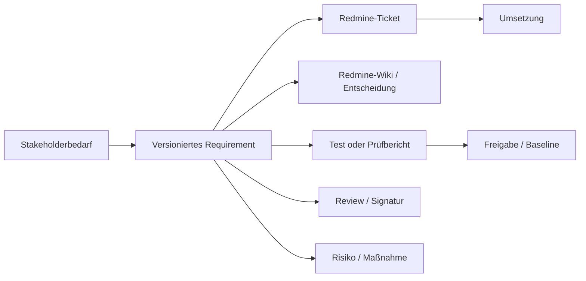
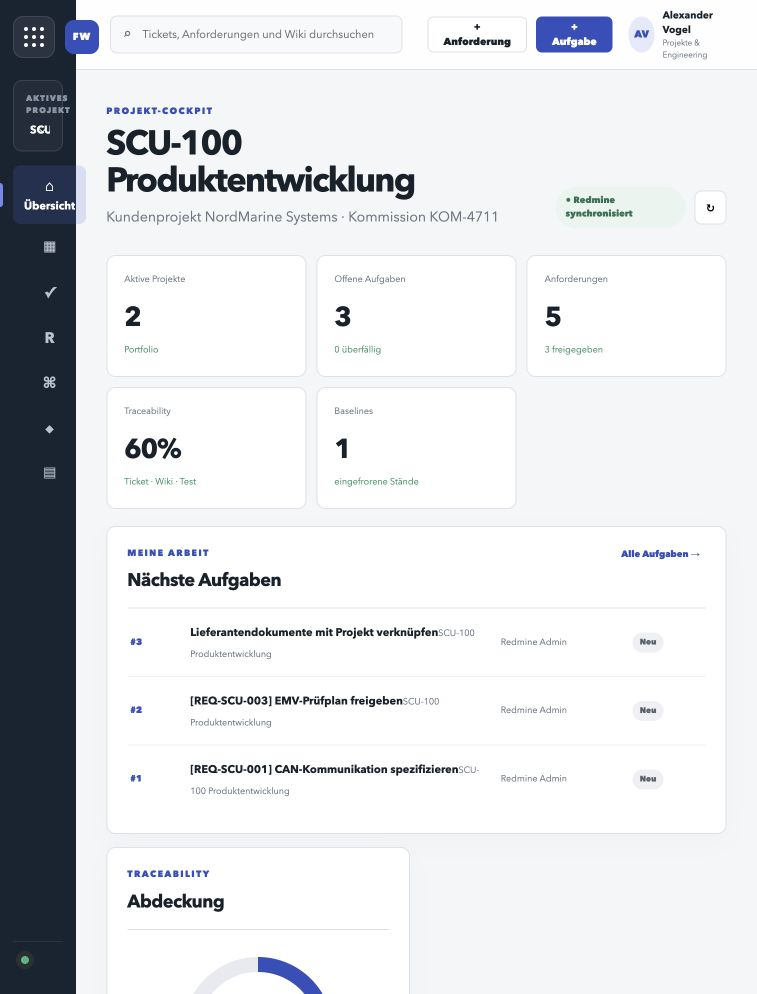
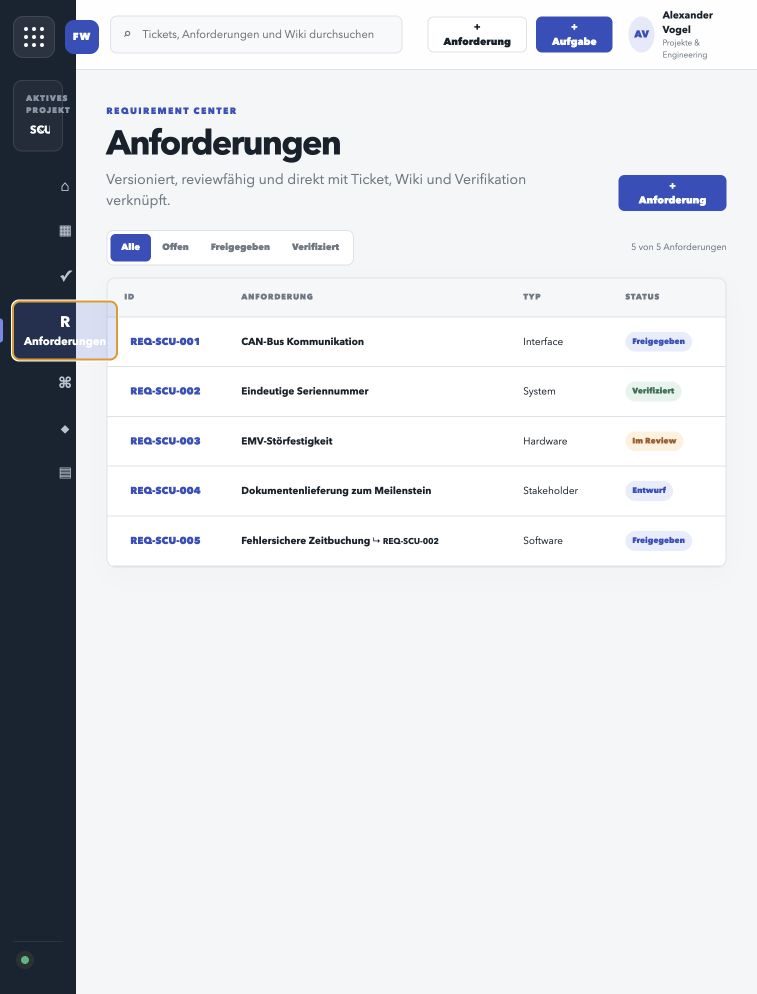
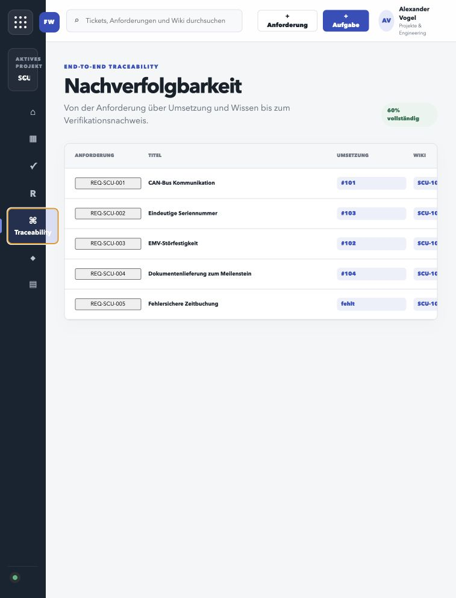

# FLOWWORK: Tickets, Wiki und Requirements

FLOWWORK kombiniert eine moderne Projektoberfläche mit Redmine als führendem
System für Projekte, Aufgaben, Zeitbuchungen und Wiki. Das Requirement Center
verwaltet versionierte Anforderungen, konfigurierbare Schemas, Reviews,
Beziehungsmodelle, Tests, Risiken, Baselines und die Verknüpfung zu Umsetzung
und Nachweis.

## Projekt-Cockpit

Die Übersicht zeigt aktive Projekte, offene und überfällige Aufgaben,
Requirements, Traceability-Abdeckung und Baselines. **Nächste Aufgaben** stammt
bei konfigurierter API live aus Redmine; ohne API läuft derselbe Bedienablauf
auf reproduzierbaren Demodaten.

Über **Aktives Projekt** wird die Sicht projektbezogen umgeschaltet. Ticket-,
Requirement-, Wiki-, Baseline- und Kennzahlensichten folgen dieser Auswahl.

## Aufgabe anlegen

1. **+ Aufgabe** wählen.
2. Titel, Beschreibung, Priorität, Termin und Verantwortlichen erfassen.
3. Optional ein Requirement auswählen.
4. Speichern. Im Live-Modus wird das Ticket über `POST /issues.json` in
   Redmine angelegt; die Ticketnummer wird im Requirement gespeichert.

## Requirement anlegen und freigeben

1. **+ Anforderung** wählen.
2. Typ, Priorität, Titel und prüfbaren Anforderungstext erfassen.
3. Messbares Akzeptanzkriterium und fachlichen Owner festlegen.
4. Optional eine übergeordnete Anforderung wählen.
5. Über **Review Center** ein Review-Paket mit Reviewer, Approver, Frist und
   optionaler elektronischer Signatur starten.
6. Nach erfolgreichem Test den Datensatz in **Verifiziert** setzen.

Jede fachliche Änderung erhöht die Version und erzeugt einen Historieneintrag
mit Benutzer, Zeitpunkt, Änderungsnotiz und betroffenen Feldern.

Der Itemtyp bestimmt den Workflow und die sichtbaren eigenen Felder. Pflicht-,
Auswahl-, Mehrfachauswahl-, Zahlen-, Datums-, URL- und Ja/Nein-Felder werden
vor dem Speichern serverseitig geprüft.

## Traceability

| Element | Beispiel |
|---|---|
| Anforderung | `REQ-SCU-001` |
| Umsetzung | Redmine `#101` |
| Wissen / Entscheidung | Wiki `SCU-100_Requirements` |
| Verifikation | `TC-CAN-042` |

Neben der kompakten Ticket-/Wiki-Sicht berechnet das Relationship-Modell die
fachliche Coverage. Regeln definieren erlaubte Upstream-/Downstream-Itemtypen,
Beziehungstyp, Mindestanzahl und Coverage-Relevanz. Ändert sich ein
Upstream-Objekt fachlich, werden alle abhängigen Beziehungen automatisch als
**Suspect** markiert. Nach einer Auswirkungsanalyse wird der Link über
**Bewertet** wieder freigegeben.

## Review Center

1. **+ Review starten** wählen und Requirements markieren.
2. Mindestens einen Approver, optional weitere Reviewer und eine Frist
   festlegen.
3. Bei regulierten Freigaben **Elektronische Signatur verlangen** aktivieren.
4. Teilnehmer kommentieren einzelne Items; `@mentions` werden als strukturierte
   Erwähnungen gespeichert.
5. Reviewer schließen ihre Prüfung ab. Approver signieren oder fordern
   Änderungen an.
6. Erst wenn alle Approver zugestimmt haben, erhält das Review den Status
   **Freigegeben**. Die Signatur, Person, Zeit und Entscheidung bleiben im
   Auditobjekt erhalten.

## Eigene Itemtypen, Felder und Relationship-Modelle

Unter **Konfiguration** können Administratoren ohne Codeänderung:

- eigene Itemtypen mit Präfix und Workflow anlegen,
- eigene Felder an Itemtypen binden,
- vorwärts und rückwärts benannte Beziehungstypen definieren,
- Relationship-Regeln mit Mindestabdeckung konfigurieren,
- konkrete Beziehungen zwischen Requirements, Risiken und Testfällen anlegen.

Das vorkonfigurierte Traceability Information Model enthält Stakeholder- zu
Systemanforderungen, Systemzerlegung, Requirement-zu-Testfall sowie
Risiko-zu-Anforderung. Die Regeln sind Demowerte und müssen vor dem
Produktivbetrieb an den Entwicklungsprozess angepasst und freigegeben werden.

## Tests und Nachweise

Testfälle enthalten Vorbedingungen, geordnete Schritte, erwartetes Ergebnis,
Owner, Status und Version. Beim Anlegen kann direkt ein Requirement gewählt
werden; FLOWWORK erzeugt die typisierte `verifies`-Beziehung.

Über **+ Testplan** werden Testfälle zu einem Lauf gebündelt. Jede Ausführung
speichert Ergebnis, Benutzer, Zeitpunkt, Evidenzreferenz und optional ein
Redmine-Defect. Fehlgeschlagene oder blockierte Prüfungen sind sofort im
Test-Cockpit sichtbar.

## Risiken und Varianten

Risiken werden mit Wahrscheinlichkeit und Auswirkung von 1 bis 5 bewertet.
Der Score, Owner, Status und die Maßnahme werden versioniert angezeigt; die
Verknüpfung zum Requirement erfolgt über `mitigates`.

In der Requirement-Detailansicht erzeugt **Variante ableiten** eine unabhängige
Version mit Herkunftsreferenz. Freigegebene Bausteine können in Katalogen als
wiederverwendbare Anforderungen gesammelt werden.

## Baseline

Eine Baseline friert Requirement-IDs, Versionen und Statuswerte ein. Spätere
Änderungen erzeugen neue Requirement-Versionen, verändern aber den Snapshot
nicht. Für SRR, PDR, CDR, FAT oder eine Kundenlieferung sollte jeweils eine
benannte Baseline erzeugt werden. **Mit aktuellem Stand vergleichen** zeigt
geänderte Versionen und nach der Baseline neu hinzugekommene Requirements.

## Austausch und Migration

Unter **Konfiguration** stehen JSON- und ReqIF-Export zur Verfügung. Die API
liefert zusätzlich CSV. JSON enthält Itemtypen, eigene Felder,
Relationship-Regeln, Requirements, Beziehungen, Tests, Risiken und Baselines
und kann über `POST /api/work/import` idempotent ergänzt werden. ReqIF ist für
den toolübergreifenden Austausch vorgesehen; vor einem produktiven Austausch
muss der konkrete Partnerimport mit einem Roundtrip-Test qualifiziert werden.

## Rollen

- `work-user`: Cockpit, Board, Aufgaben und Wiki
- `requirements-user`: Requirements, Traceability und Baselines
- `work-admin`: Projektvorlagen, Redmine-Direktzugriff und Administration
- `platform-admin`: vollständiger Plattformzugriff

Die technischen Verträge stehen unter
[Redmine und Requirements](../interfaces/redmine-requirements.md).
