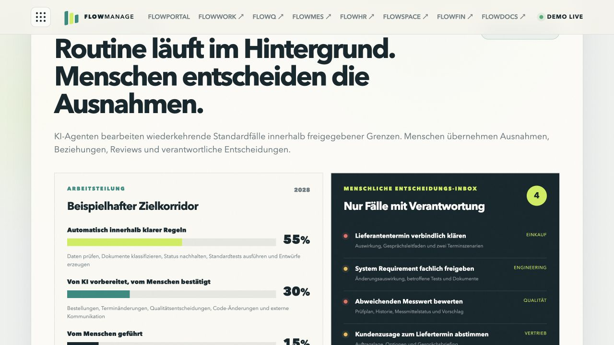
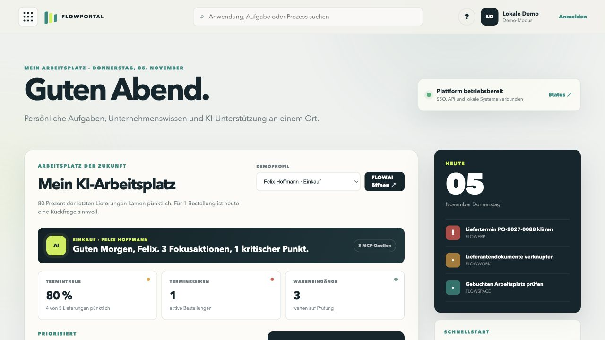
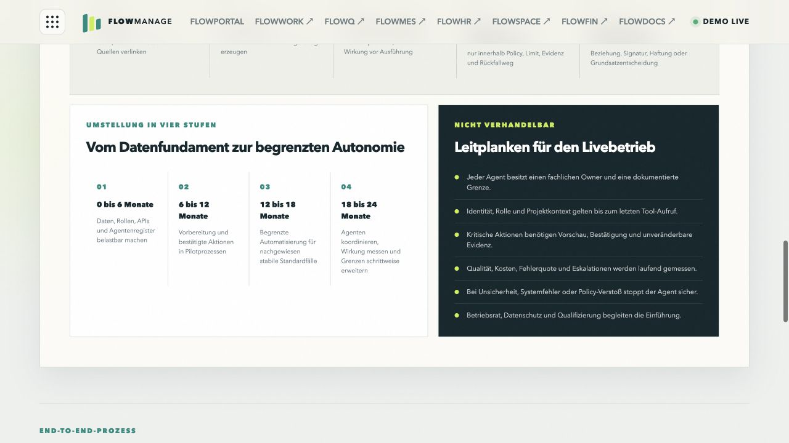

# Persönlicher KI-Arbeitsplatz

FLOWPORTAL bündelt nicht nur Anwendungen. Der Bereich **Mein KI-Arbeitsplatz**
stellt für jeden Mitarbeiter ein rollenabhängiges Tagesbriefing zusammen. Die
Ansicht zeigt persönliche Fokusaktionen, Kennzahlen, freigegebene KI-Agenten
und passende Einstiege in die Fachanwendungen.

[Persönlichen Einkaufsarbeitsplatz öffnen](http://localhost:8088/?user_id=USR-006&date=2026-11-05)

[Management-Zielbild Arbeitsplatz 2028 öffnen](http://localhost:8088/management#future-model)

## Ablauf am Morgen

1. Über Keycloak anmelden. In der lokalen Demo kann stattdessen ein Demoprofil
   gewählt werden.
2. Das Tagesbriefing lesen. FLOWPORTAL priorisiert kritische Punkte vor
   normalen Aufgaben.
3. Eine Fokusaktion direkt in FLOWERP, FLOWWORK, FLOWMES, FLOWQ, FLOWHR,
   FLOWSPACE oder FLOWFIN öffnen.
4. **Mit KI besprechen** wählen und den vorbereiteten Prompt in FLOWAI nutzen.
5. Die KI fasst nur freigegebene Daten zusammen und nennt die verwendeten
   Quellen. Eine Buchung, Freigabe oder externe Nachricht benötigt weiterhin
   eine ausdrückliche Bestätigung im zuständigen Fachprozess.

## Beispiele je Rolle

| Rolle | Persönliche Sicht | Beispielagent |
|---|---|---|
| Einkauf | Liefertermintreue, verspätete Bestellungen, offene Wareneingänge und Lieferantendokumente | Lieferanten-Agent |
| Entwicklung | eigene Tasks, Requirements, Reviewkommentare, Suspect Links und Nachweise | Requirements-Agent |
| Produktion | nächster ausführbarer Arbeitsgang, Material, Anleitung und Sollzeit | Shopfloor-Agent |
| Qualität | offene Wareneingangsprüfungen, Stichproben, Messmittel und Reviews | Prüf-Agent |
| Disposition | Fertigungsfortschritt, Fehlteile, Kapazität und Liefertermin | Planungs-Agent |
| Lager | Wareneingang, Seriennummern, Prüfstatus und Ziellager | Lager-Agent |
| Vertrieb | Kundenaufträge, erwartete Rechnung und Lieferrisiko | Kunden-Agent |
| Personal | Anträge, Teamkalender, Recruiting und Payroll | People-Agent |
| Finanzen | überfällige Posten, Cash und Budgetabweichungen | Controlling-Agent |
| IT | Betriebsstatus, MCP-Abdeckung, Zugriffe und Integrationsrisiken | Operations-Agent |

Im Einkaufsbeispiel zeigen fünf Lieferungen eine Termintreue von `80 %`.
`PO-2027-0088` ist zwei Tage verspätet. FLOWAI kann das Risiko erklären und
eine Lieferantenanfrage formulieren. Das System versendet sie nicht selbst.

Im Engineering-Beispiel zeigt das Profil `USR-045 · Helena Friedrich` Ticket
`#101`, das zugehörige Requirement und einen offenen Reviewkommentar. Der
Requirements-Agent kann Änderungskontext und Nachweise zusammenfassen.

## Zielbild für die nächsten 12 bis 24 Monate

Das realistische Ziel ist ein **ausnahmeorientierter Arbeitsplatz**. Agenten
bearbeiten wiederkehrende Standardfälle innerhalb fachlich freigegebener
Grenzen. Der Mensch erhält eine kleine Entscheidungs-Inbox mit den Fällen, in
denen Beziehung, Erfahrung, Signatur, Haftung oder ein Zielkonflikt eine
verantwortliche Entscheidung verlangen.

Das Management-Cockpit verwendet folgenden beispielhaften Zielkorridor. Die
Anteile sind ausdrücklich eine Pilotannahme und kein gemessener Produktivwert:

| Arbeitsteilung | Szenarioanteil | Beispiele |
|---|---:|---|
| automatisch innerhalb klarer Regeln | 55 % | Daten prüfen, Dokumente klassifizieren, Status nachhalten, Standardtests ausführen und Entwürfe erzeugen |
| von KI vorbereitet, vom Menschen bestätigt | 30 % | Bestellungen, Terminänderungen, Qualitätsentscheidungen, Code-Änderungen und externe Kommunikation |
| vom Menschen geführt | 15 % | Verhandlungen, Kundenversprechen, Requirements-Freigaben, Personalentscheidungen, Sicherheit und Architektur |

Die Zahlen dürfen erst nach einem Pilot durch echte Messwerte ersetzt werden.
Geeignete Kennzahlen sind Durchlaufzeit, First-Time-Right-Rate, Korrekturen,
Eskalationen, vermiedene Suchzeit, Benutzerakzeptanz und Fehlerfolgekosten.

### Typische Arbeitsteilung

| Bereich | Agent übernimmt | Mensch bleibt verantwortlich |
|---|---|---|
| Einkauf | Bedarfe prüfen, Terminabweichungen erkennen, Gesprächsbriefing und Anfrage entwerfen | Lieferantengespräch, Preis, Vertragsfrage und verbindliche Terminentscheidung |
| Engineering | Requirement-Kontext, Code- und Testentwürfe, Traceability und Dokumentation vorbereiten | Architektur, Security, Safety, fachliches Review, Merge und Release |
| Produktion | nächste ausführbare Arbeit ermitteln, Anleitung erklären, Materialkontext prüfen | tatsächliche Ausführung, Abweichung, Arbeitssicherheit und qualifizierte Rückmeldung |
| Qualität | Stichprobe berechnen, Messwerte einlesen, Historie und Prüfplan zusammenstellen | Sperre, Freigabe, Reklamation und Bewertung außerhalb eindeutiger Regeln |
| Planung | Szenarien für Material, Kapazität und Termin rechnen | Zielkonflikte entscheiden und Kunden- oder Lieferantenzusagen verantworten |
| Vertrieb | Kundenbriefing, Auftragsstatus und Antwortentwurf vorbereiten | Beziehung, Verhandlung, Preis und verbindliches Leistungsversprechen |
| HR | Anträge strukturieren, Termine nachhalten und datensparsame Zusammenfassungen erzeugen | Personalentscheidung, Konflikt, Vergütung und arbeitsrechtliche Bewertung |
| Finanzen | Kontrollen, Zuordnungsvorschläge und Forecast-Erklärungen vorbereiten | Buchungsfreigabe, Zahlungsentscheidung, Compliance und externe Meldung |

Auch in der Softwareentwicklung bleibt der Mensch verantwortlich. Ein
Engineering-Agent kann Implementierung, Tests, Dokumentation und Pull Request
vorbereiten. Requirement, Architektur, Sicherheitsbewertung, Review und
Releasefreigabe bleiben getrennte menschliche Kontrollpunkte.

## Autonomiestufen

| Stufe | Bedeutung | Voraussetzung |
|---|---|---|
| A0 | erklären und Quellen verlinken | lesender Zugriff und Rollenprüfung |
| A1 | Entwurf oder Entscheidungsvorlage erzeugen | prüfbarer Kontext und Quellen |
| A2 | nach menschlicher Bestätigung ausführen | Vorschau, Wirkung, Bestätigung und Audit |
| A3 | innerhalb enger Grenzen automatisch ausführen | Policy, Limit, Tests, Monitoring und sicherer Rückfallweg |
| A4 | bleibt beim Menschen | Beziehung, Signatur, Haftung oder Grundsatzentscheidung |

Ein Agent wechselt nicht aufgrund einer Modellbehauptung auf A2 oder A3. Die
Organisation muss Qualität, Fehlerquote, Grenzfälle und Rückfallverhalten mit
realen Prozessdaten nachweisen.

## Umstellung in vier Stufen

| Zeitraum | Schwerpunkt |
|---|---|
| 0 bis 6 Monate | Daten, Rollen, APIs und Agentenregister belastbar machen |
| 6 bis 12 Monate | Vorbereitung und bestätigte Aktionen in Pilotprozessen |
| 12 bis 18 Monate | begrenzte Automatisierung für nachgewiesen stabile Standardfälle |
| 18 bis 24 Monate | Agenten koordinieren, Wirkung messen und Grenzen schrittweise erweitern |

Die Umstellung erfolgt pro Prozess, nicht pauschal pro Anwendung. Ein stabiler
Dokumentenabgleich kann bereits A3 erreichen, während eine Lieferzusage oder
eine Requirements-Freigabe dauerhaft auf A2 beziehungsweise A4 bleibt.

## Was für das Zielbild noch fehlt

Für einen belastbaren Produktivbetrieb braucht die Plattform zusätzlich:

- ein zentrales Agentenregister mit fachlichem Owner, erlaubten Tools,
  Autonomiestufe, Kostenlimit und Eskalationsregel,
- durchgängige Benutzerdelegation über Keycloak, API und MCP bis zum letzten
  Fachsystem,
- eine Policy Engine für Betragsgrenzen, Vier-Augen-Regeln, Projektkontext und
  verbotene Aktionen,
- Ereignisse und Workflows, damit Agenten auf fachliche Zustandsänderungen
  reagieren, ohne Datenbanken abzufragen,
- Evaluation und Observability für Antwortqualität, Tool-Erfolg, Korrekturen,
  Laufzeit, Kosten und sichere Abbrüche,
- unveränderbare Evidenz für Eingabedaten, Modell- und Promptversion,
  Tool-Aufruf, Bestätigung und Ergebnis,
- Sandbox, Simulation, Rollback und Kill Switch für jede schreibende
  Agentenklasse,
- Datenschutz, Betriebsvereinbarung, Qualifizierung und klare Regeln zur
  Leistungskontrolle,
- Betriebsmodelle für Modellwechsel, Ausfall, Datenalterung und manuelle
  Weiterarbeit.

Das Management-Zielbild zeigt diese Grenzen bewusst. Die Plattform soll keine
unsichtbare Vollautomatisierung vortäuschen, sondern Autonomie schrittweise
verdienen und Ausnahmen zuverlässig an den richtigen Menschen geben.

## MCP-Abdeckung

Heute sind drei MCP-Server mit Open WebUI verbunden:

| Server | Abdeckung | Modus |
|---|---|---|
| Plattform/ERP | ERP-Abfragen, persönliches Tagesbriefing, Aktionskontext und kontrollierte Testdaten | lesen; Testdaten nach Vorschau und Bestätigung |
| DMS | freigegebene Dokumentmetadaten und kurze OCR-Treffer | nur lesen |
| Prozess-Wiki | Prozesse, Benutzeranleitungen und Administration | nur lesen |

Der Plattform-MCP ergänzt folgende persönliche Werkzeuge:

- `get_personal_daily_brief`: rollenabhängige Tagesübersicht,
- `list_personal_ai_tools`: verfügbare und geplante Werkzeuge für das Profil,
- `get_personal_action_context`: Quellkontext und Sicherheitsgrenze einer
  Fokusaktion,
- `get_future_operating_model`: Zielbild, Entscheidungs-Inbox,
  Agentenregister und Autonomiestufen für das Management.

Es gibt bewusst noch **nicht** für jede Fachanwendung einen eigenen
vollständigen MCP-Server. FLOWWORK-, MES-, FLOWQ-, FLOWHR-, FLOWSPACE- und
FLOWFIN-Schreibaktionen sind im Werkzeugkatalog als geplant oder
bestätigungspflichtig gekennzeichnet. Für den Livebetrieb müssen Open WebUI,
MCP-Gateway und Fachsystem die Keycloak-Identität und Rollen durchgängig
prüfen.

## Sicherheitsmodell für Agenten

| Stufe | Erlaubnis |
|---|---|
| Lesen | freigegebene Daten suchen, filtern, erklären und verlinken |
| Vorbereiten | Entwurf, Vergleich oder Entscheidungsvorschlag erzeugen |
| Bestätigen | Benutzer prüft Ziel, Daten und Wirkung vor einer Fachaktion |
| Ausführen | Fachsystem bucht mit Benutzeridentität und schreibt Auditdaten |

Ein Agent darf keine Lieferantenmail versenden, keinen Prüfentscheid treffen,
keine Zeit buchen und keine HR- oder Finanzfreigabe erteilen, solange keine
explizit autorisierte und auditierte Werkzeugaktion vorhanden ist.

## API

| Endpunkt | Zweck |
|---|---|
| `GET /api/workplace/profiles` | verfügbare Demoprofile und Rollen |
| `GET /api/workplace/today?user_id=USR-006&selected_date=2026-11-05` | persönliches Tagesbriefing |
| `GET /api/workplace/tools?user_id=USR-006` | persönlicher Werkzeugkatalog |
| `GET /api/workplace/future-model` | Management-Zielbild, Entscheidungs-Inbox, Agentenregister und Autonomiestufen |
