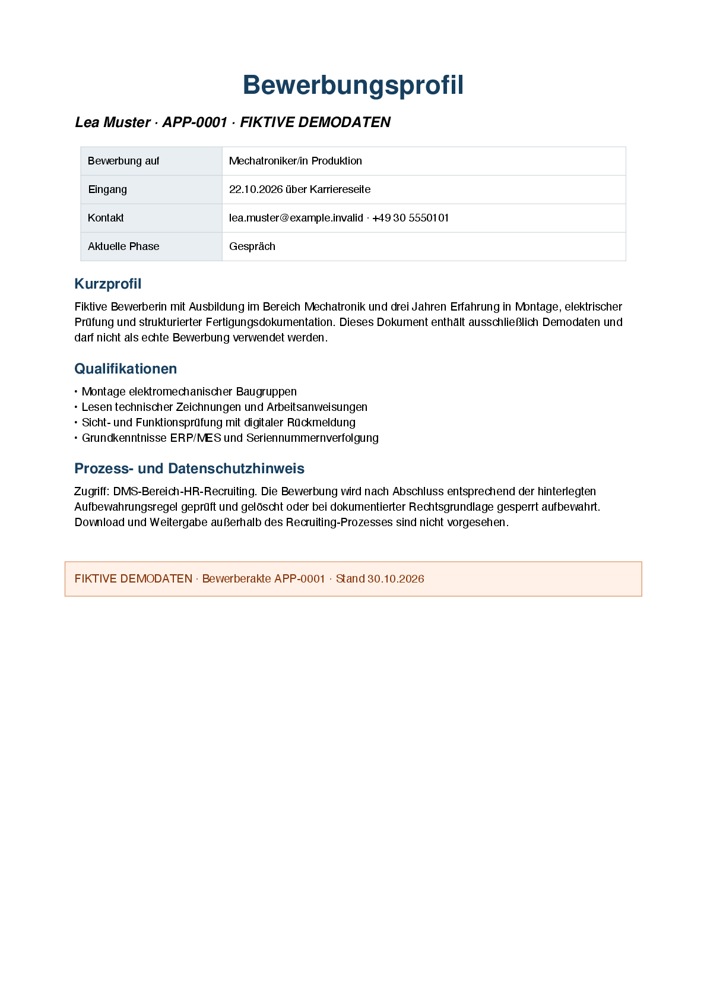
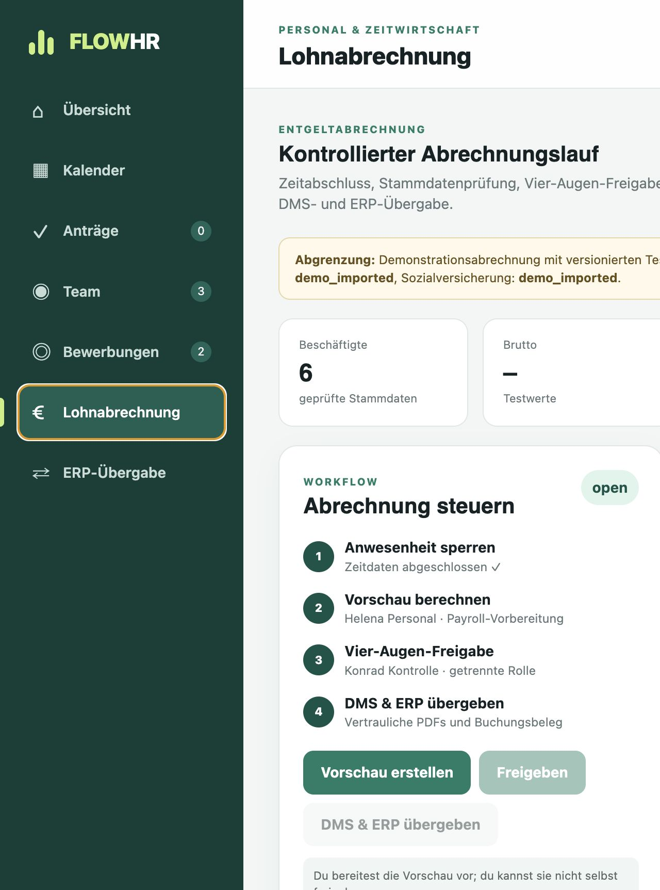

# FLOWHR: Anwesenheit und Zeitwirtschaft

FLOWHR unter [localhost:8088/hr](http://localhost:8088/hr) bildet den
operativen Teil einer Personalzeitwirtschaft ab: Kommen/Gehen, persönliches
Zeitkonto, Urlaub, Überstundenabbau, Mehrarbeitsanträge, mobiles Arbeiten,
Dienstreisen, Zeitkorrekturen, Teamkalender und Genehmigungen. Genehmigte
Anwesenheitsintervalle können kontrolliert an ERPNext übergeben werden.
Zusätzlich sind Stellen und Bewerbungen mit geschützter DMS-Akte sowie ein
Vier-Augen-Abrechnungslauf mit direkt im Browser angezeigten PDFs testbar.

!!! warning "Identität in der Demo"
    Die Person wird im PoC über den Auswahlschalter gewählt. Das ist praktisch
    für die Präsentation, aber **keine Anmeldung**. Im Livebetrieb müssen
    Keycloak/OIDC, die serverseitige Zuordnung `User → Employee`, Rollen und
    Projekt-/Teamgrenzen erzwungen werden.

## Mein Arbeitstag

1. oben rechts die Testperson und das Datum wählen.
2. Status, Tages-Soll, gebuchte Zeit, Tagessaldo, Zeitkonto und Resturlaub
   prüfen.
3. bei Arbeitsbeginn **Kommen buchen** wählen.
4. bei Arbeitsende **Gehen buchen** wählen.
5. Warnungen zur Mindestpause oder zur täglichen Höchstarbeitszeit beachten.

Eine offene Kommen-Buchung kann nicht doppelt gestartet werden. Ein Gehen ohne
vorheriges Kommen wird ebenfalls abgelehnt. Während eines genehmigten
ganztägigen Urlaubs oder einer Krankheitsabwesenheit ist Kommen gesperrt.

Die Anwesenheitszeitleiste zeigt Zeit, Terminal, Quelle und ERP-Status. Das
Zeitkonto berücksichtigt Arbeitstage, Wochenenden, Feiertage, genehmigte
Abwesenheitsgutschriften und den Eröffnungssaldo der Demo.

## Kalender für mich und mein Team

Unter **Kalender** kann zwischen der persönlichen und – für Führungskräfte –
der Teamansicht gewechselt werden. Enthalten sind:

- Urlaub und Überstundenabbau,
- mobiles Arbeiten und Dienstreisen,
- offene Anträge als gestrichelte Planung,
- gesetzliche Feiertage,
- Abwesenheiten ohne vertrauliche Krankheitsdetails.

Andere Teammitglieder sehen bei Krankheit nur **Abwesend**. Grund und Typ
bleiben für sie verborgen. Der Teamkalender ist für normale Beschäftigte
serverseitig gesperrt.

## Antrag stellen

**Neuer Antrag** öffnet das Formular. Der Antragstyp bestimmt die Pflichtfelder:

| Antrag | Eingaben | Wirkung nach Genehmigung |
|---|---|---|
| Urlaub | Von, Bis, Begründung | Urlaubstage werden belastet und als Zeitgutschrift berücksichtigt |
| Krankmeldung | Von, Bis, Hinweis ohne Diagnose | wird anderen Teammitgliedern ausschließlich als `Abwesend` angezeigt |
| Überstundenabbau | Tag/Zeitraum, Minuten, Begründung | reduziert das Zeitkonto und deckt die entsprechende Sollzeit |
| Mehrarbeit | Tag/Zeitraum, Minuten, Begründung | dokumentiert die vorherige Genehmigung zusätzlicher Arbeit |
| Mobiles Arbeiten | Von, Bis, Begründung | kennzeichnet Ort/Status im Kalender |
| Dienstreise | Von, Bis, Begründung | kennzeichnet Abwesenheit und schreibt die Tages-Sollzeit gut |
| Zeitkorrektur | Datum, Von, Bis, Begründung | erzeugt nach Genehmigung ein auditiertes Kommen-/Gehen-Paar |

Bei Urlaub prüft FLOWHR den Restanspruch, bei Überstundenabbau den verfügbaren
Zeitkontostand und bei Abwesenheiten Überschneidungen. Mehrarbeit und
Überstundenabbau müssen zwischen 15 und 720 Minuten liegen.

## Genehmigen

Führungskräfte sehen unter **Team** ihre offenen Genehmigungen. Nach Auswahl
des Antrags wird er mit optionalem Kommentar genehmigt oder abgelehnt.

- eigene Anträge dürfen nicht selbst genehmigt werden,
- nur die zuständige Führungskraft darf entscheiden,
- bereits entschiedene Anträge sind unveränderlich,
- Antrag, Entscheidung und Korrekturbuchung erscheinen im Auditverlauf.

Im Demodatensatz ist `Paula Planung` die Führungskraft. Damit lassen sich
Urlaub von Mara, Mehrarbeit von Emil und Claras Zeitkorrektur demonstrieren.

## Bewerbungen bearbeiten

Unter **Bewerbungen** stehen zwei offene Stellen und zwei fiktive Bewerbungen
bereit. Als `Helena Personal`:

1. **+ Bewerbung** wählen, Stelle, Name, E-Mail und Quelle erfassen.
2. die Bewerbung nacheinander durch **Vorauswahl**, **Gespräch**, **Angebot**
   und **Eingestellt** führen oder begründet ablehnen.
3. vorhandene Unterlagen über **im Browser öffnen** prüfen.
4. bei live konfiguriertem Paperless PDF/JPEG/PNG bis 10 MB über
   **In DMS hochladen** in die Bewerberakte geben.
5. den angezeigten Termin zur Lösch- oder Sperrprüfung beachten.

Phasen können nicht übersprungen werden. Zu jeder Änderung werden Rolle,
Zeitpunkt und Notiz protokolliert. Die Dateinamen erhalten automatisch das
Muster `Bewerbung_<Bewerbungsnummer>_...`, damit Paperless die Unterlage in
`DMS-Bereich-HR-Recruiting` einordnet und den allgemeinen DMS-Eingang wieder
entzieht.

Der Screenshot zeigt das fiktive Dokument, das über **im Browser öffnen**
angezeigt wird. Die operative Pipeline bleibt in FLOWHR; Paperless führt die
Binärdatei, Klassifikation und Objektberechtigung.

!!! warning "Fiktive Demo und Identität"
    Die angezeigten Bewerberdaten sind fiktiv. Der Rollenwahlschalter beweist
    die Geschäftsregeln, ersetzt aber keine Anmeldung. Echte Bewerbungen
    dürfen erst nach OIDC-Anbindung, Datenschutzhinweis, Löschkonzept und
    fachlicher Abnahme verarbeitet werden.

## Lohnabrechnung testen

Unter **Lohnabrechnung** zeigt FLOWHR den Zeitraum `Oktober 2026`, maskierte
Abrechnungsstammdaten und den Status der Zeit-, ELStAM- und
Sozialversicherungsdaten.

1. `Helena Personal` auswählen und **Vorschau erstellen**.
2. Brutto, Testabzüge, Netto und Beschäftigtenzahl prüfen.
3. auf `Konrad Kontrolle` wechseln und **Freigeben** wählen. Die vorbereitende
   Person kann den eigenen Lauf nicht freigeben.
4. **DMS & ERP übergeben** wählen. Ohne Integrationszugang werden eindeutige
   Simulationsreferenzen erzeugt; mit Zugang entstehen Paperless-Tasks und ein
   ausgeglichener ERPNext-Journal-Entry.
5. unter **Abrechnungen im Browser öffnen** die einzelnen PDFs ohne Download
   prüfen.

Jede PDF enthält Bezüge, Abzüge, Netto, Personal-/Periodenreferenz und die
beiden Rollen. `DMS-Bereich-HR-Payroll` ist von Recruiting und allgemeinen
DMS-Lesern getrennt.

!!! danger "Keine produktive deutsche Payroll"
    Die Beträge sind fest versionierte Testwerte. Es werden keine gesetzlichen
    Steuer-/SV-Werte berechnet, keine Zahlung ausgelöst und keine produktiven
    ELStAM-, DEÜV-, eAU- oder Bescheinigungsmeldungen gesendet. Dafür ist ein
    validierter Payroll-Provider anzubinden. Verträge und Go-live-Grenzen stehen
    unter [Recruiting, Payroll, DMS und ERP](../interfaces/hr-dms-payroll.md).

## Anwesenheit an ERPNext übergeben

Unter **ERP-Übergabe**:

1. Person und Datum prüfen.
2. **Übergabe prüfen** wählen.
3. Intervalle und Gesamtstunden kontrollieren.
4. erst danach **Verbindlich übergeben** wählen.

Bei konfiguriertem ERPNext wird genau ein Timesheet mit Activity Type
`Anwesenheitszeit` angelegt. Ohne ERP-Verbindung protokolliert der Demo-Adapter
denselben Vertrag lokal. Die Kombination aus Person und Datum ist idempotent:
ein zweiter Aufruf liefert die vorhandene Referenz und erzeugt kein Duplikat.

Abwesenheitsanträge werden in der aktuellen Ausbaustufe nicht als ERPNext
Leave Application geschrieben; FLOWHR bleibt dafür die führende Quelle. Der
vollständige Vertrag ist unter
[FLOWHR zu ERPNext](../interfaces/hr-erpnext.md) beschrieben.

## Anwesenheit ist nicht Fertigungszeit

| Zeitart | Führendes System | Zweck |
|---|---|---|
| Anwesenheit | FLOWHR | Arbeitszeitgesetz, Zeitkonto, Urlaub und Personalplanung |
| Arbeitsgangzeit | FLOWMES / ERPNext Job Card | Soll-Ist, Menge, Arbeitsplatz und Fertigungskosten |
| Projekt-/Engineeringzeit | ERPNext Timesheet | Projekt, Tätigkeit und gegebenenfalls Abrechnung |

Ein Mitarbeiter kann acht Stunden anwesend sein, aber nur sechs Stunden auf
Arbeitsgänge buchen. Die Differenz kann Pause, Besprechung, Rüsten oder andere
Tätigkeit sein und muss fachlich abgestimmt statt automatisch gleichgesetzt
werden.

## Demo zurücksetzen

`POST /api/hr/reset` stellt nur den HR-Demobereich aus dem versionierten Seed
wieder her. MES-, DMS- und Portalzustände bleiben unverändert. Die Schaltfläche
ist absichtlich nur als Demo-/Testfunktion vorgesehen und darf im Livebetrieb
nicht angeboten werden.
