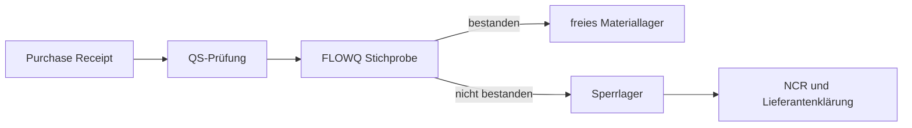

# FLOWQ – Wareneingangsprüfung

FLOWQ ist der einfache Prüfplatz zwischen Wareneingang und ERPNext. Lager- und
Qualitätsmitarbeiter müssen dafür weder den vollständigen ERPNext-Desk noch das
Requirements-System bedienen. Der operative Beleg bleibt dennoch mit
Purchase Receipt, Charge, Lagerentscheidung, Prüfplanrevision und Nachweisen
verbunden.

**Aufruf:** [FLOWQ öffnen](http://localhost:8088/quality)

## Systemgrenzen

| Inhalt | Führendes System |
|---|---|
| Bestellung, Purchase Receipt, Charge/Seriennummer und Bestand | FLOWERP / ERPNext |
| Prüfablauf, Stichprobe und Messwerte | FLOWQ |
| Prüfplanreview, Testfälle, Beziehungen und Baseline | FLOWWORK |
| Freigegebene Prüfanweisung, Zertifikat und Prüfprotokoll | FLOWDOC |

FLOWQ ist eine getrennte Erweiterung und verändert keinen ERPNext-Kerncode.
Die ERP-Übergabe erfolgt ausschließlich über die dokumentierte API.

## Wareneingang prüfen

1. Wareneingangsnummer, Bestellung, Artikel oder Charge oben scannen.
2. Menge, Lieferant, Zwischenlager, Prüfplan und Revision kontrollieren.
3. **Stichprobe ermitteln und Prüfung starten** wählen.
4. Die vom System ausgewählten Probennummern nacheinander öffnen.
5. Numerische Werte eingeben oder **Vom Messgerät** wählen.
6. Sicht- und Identprüfungen mit **Bestanden** oder **Abweichung** buchen.
7. Nach allen Pflichtmerkmalen **Prüfung abschließen** wählen.
8. ERP-Übergabe bestätigen; das Prüfprotokoll anschließend in FLOWDOC öffnen.

Die Demo enthält drei Verfahren:

- konfigurierbare AQL-Stichprobe,
- prozentuale Stichprobe mit Mindest- und Höchstmenge,
- vollständige Prüfung aller Seriennummern.

Die AQL-Demowerte sind keine freigegebene Normtabelle. Im Pilot werden sie
durch die genehmigte betriebliche Prüfanweisung beziehungsweise lizenzierte
Normwerte ersetzt.

## Lagerentscheidung

Ein fehlender Pflichtwert verhindert den Abschluss. Ist die zulässige
Fehlerzahl überschritten, setzt FLOWQ das Los auf `rejected`, bereitet das
Sperrlager als Ziel vor und eröffnet eine NCR-Referenz. Die finale
Bestandsbuchung bleibt ein kontrollierter ERP-Vorgang.

## Messmittel

Für numerische Merkmale kann der Prüfplan erlaubte Messmitteltypen vorgeben.
FLOWQ kontrolliert vor jeder Übernahme:

- Messmittel-ID und Typ,
- Aktivstatus,
- Kalibriergültigkeit,
- Einheit des Messwertes,
- eindeutige Ereignis-ID bei Geräteübertragung.

Abgelaufene oder gesperrte Messmittel können keinen Messwert liefern. Nach
einer Kalibrierung werden Datum, Gültigkeit und FLOWDOC-Zertifikats-ID erfasst.

## Management-Demo

Im geführten Rundgang ist FLOWQ direkt nach Einkauf und Lager eingeordnet.
Gezeigt werden `PREC-2027-0045`, acht automatisch ausgewählte Proben, ein
über den REST-Gateway simulierter Messwert sowie die Traceability zu FLOWERP,
FLOWWORK und FLOWDOC.

Die Demo lässt sich innerhalb von FLOWQ über **Demodaten zurücksetzen** wieder
auf den Ausgangszustand bringen.

## Weiterführende Informationen

- [Messgeräte- und ERP-Schnittstelle](../interfaces/quality-measurement.md)
- [Qualitätsprozess und Dokumentenlenkung](../processes/order-to-cash/quality.md)
- [Einkauf und Wareneingang](../processes/order-to-cash/procurement.md)
- [FLOWWORK Tickets und Requirements](flowwork.md)

