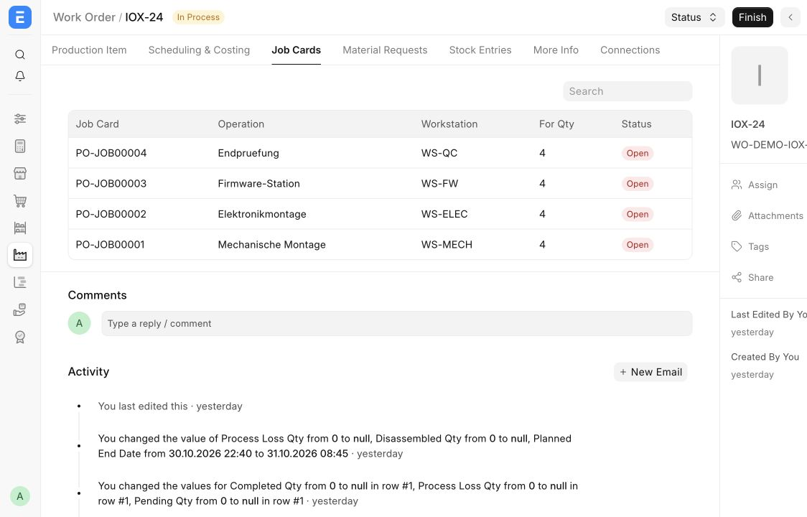

# Shopfloor-Anleitung

Die hier beschriebenen Handlungen können im neuen
[FLOWMES-Arbeitsplatz](mes.md) zusammenhängend demonstriert werden. FLOWMES
zeigt Arbeitsvorrat, Fertigungsroute, Anweisungen, DMS-Unterlagen,
Zeitbuchungen und Rückmeldung in einer Bedienoberfläche; ERPNext bleibt das
führende System für Work Order, Job Card, Bestand und Kosten.

## Arbeitsgang starten

1. Mit persönlichem Konto anmelden.
2. **Meine Job Cards** öffnen.
3. WO-2027-0042 und den zugewiesenen Arbeitsgang wählen.
4. Artikel, Revision, Menge und Arbeitsplatz prüfen.
5. Verlinkte Zeichnung und Montageanweisung öffnen.
6. Seriennummern übernehmen und **Start** wählen.

## Arbeitsgang rückmelden

Erfasse Ist-Zeit, Gutmenge, Ausschuss/Nacharbeit und gegebenenfalls Messwerte.
Mit **Abschließen** bestätigst du, dass die dokumentierte Arbeit nach aktueller
Anweisung ausgeführt wurde.

Die Geräte-Seriennummer wird spätestens in der Endmontage am physischen Gerät
angebracht und gescannt. Verwende dieselbe Nummer in Funktionstest,
Endprüfung und Fertigmeldung; eine neue oder korrigierte Nummer darf nicht
nachträglich nur in einer Nebenliste geführt werden.

!!! danger "Nicht fortsetzen"
    Stoppe bei falscher Revision, fehlendem Material, beschädigtem Teil,
    unerwartetem Maschinenzustand oder nicht bestandener Prüfung. Erzeuge eine
    Abweichung, statt den Arbeitsgang als gut abzuschließen.

## Funktionstest

1. Seriennummer eindeutig scannen.
2. Prüfplan Rev. B öffnen.
3. Spannung und Strom erfassen.
4. Temperatur- und Kommunikationstest ausführen.
5. Alle Ergebnisse speichern.
6. Bei Fehler **Abweichung anlegen** wählen.

## Ende der Schicht

- Offene Arbeitsgänge pausieren und Grund angeben.
- Materialreste korrekt zurückmelden.
- Störungen und ungeklärte Abweichungen an den Schichtleiter übergeben.
- Keine Sammelrückmeldung unter einem fremden Benutzerkonto durchführen.
